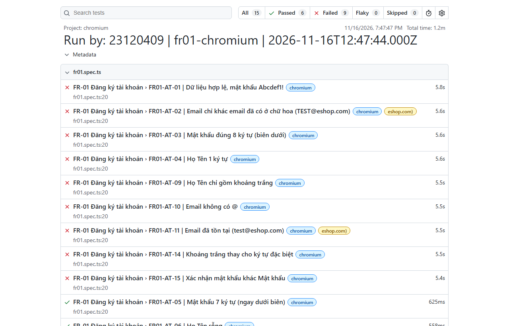
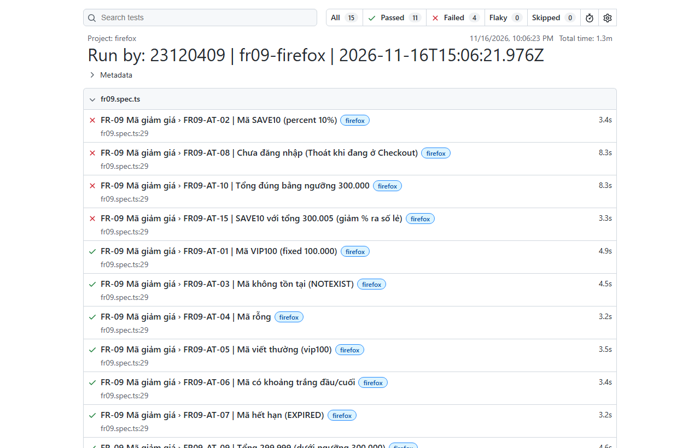
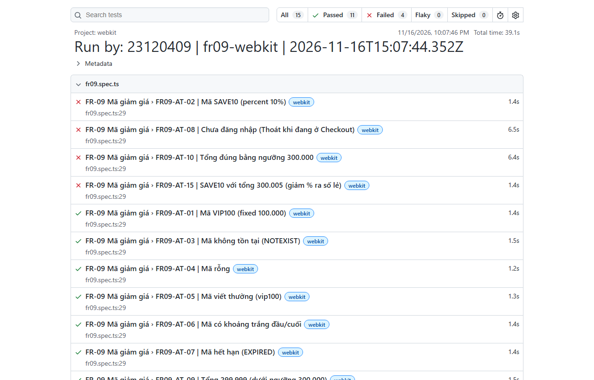

# HW04 — Automation Testing trên EShop

| Thông tin | Nội dung |
| :--- | :--- |
| Họ và tên | NGUYỄN KHẮC VƯỢNG |
| MSSV | 23120409 |
| Lớp | CSC13003 - 23_3 |
| Mã bài tập | HW#04 |
| Ngày hoàn thành báo cáo | |
| Repository thực hiện bài | [vinny2707/eshop-sut-HW04](https://github.com/vinny2707/eshop-sut-hw04) (từ [ttbhanh/eshop-sut](https://github.com/ttbhanh/eshop-sut), commit gốc `85af3ba`) |
| Trang GitHub Issues | [vinny2707/eshop-sut-HW04/issues](https://github.com/vinny2707/eshop-sut-hw04/issues) |

## Mục lục

1. [Phạm vi](#1-phạm-vi)
2. [Môi trường và phương pháp](#2-môi-trường-và-phương-pháp)
3. [Pool A — FR-01: Registration](#3-pool-a--fr-01-registration)
4. [Pool B — FR-09: Discount Coupons](#4-pool-b--fr-09-discount-coupons)
5. [Pool C — FR-17: Coupon CRUD](#5-pool-c--fr-17-coupon-crud)
6. [Tổng hợp kết quả](#6-tổng-hợp-kết-quả)
7. [Video demo và Agent Skill](#7-video-demo-và-agent-skill)
8. [Checklist bài nộp](#8-checklist-bài-nộp)

## 1. Phạm vi

| Pool | Tính năng được chọn | Nền tảng | Mục đặc tả |
| :--- | :--- | :--- | :--- |
| A | Registration | Frontend Web | FR-01 |
| B | Discount Coupons | Frontend Web / Checkout | FR-09 |
| C | Coupon CRUD | Web Admin | FR-17 |

Bài làm cá nhân. Ba tính năng trên là ba tính năng web đã chọn ở HW02, không trùng với các thành viên khác trong nhóm. Kết quả mong đợi dựa trên [Đặc tả EShop](../../README.md); test case được chọn từ báo cáo HW02.

## 2. Môi trường và phương pháp

### 2.1. Môi trường

| Thành phần | Chi tiết |
| :-- | :-- |
| SUT | EShop, commit `85af3ba`; Backend … ; Frontend Web … ; Web Admin … |
| Automation | Playwright … , Node … , Playwright HTML reporter |
| Trình duyệt | Chromium … / Firefox … / WebKit … |
| Máy chạy test | |
| Dữ liệu nền | _(cách reset DB, tài khoản và mã giảm giá seed)_ |
| Công cụ AI | |

### 2.2. Thiết kế automation

- **Data-driven:** _(định dạng file data, cách script đọc, một dòng dữ liệu ứng với một test)_
- **Đa trình duyệt và "Run by":** _(3 project, mỗi lượt chạy một thư mục report, vị trí hiển thị "Run by: 23120409" và timestamp ISO)_

| # | Assertion pattern | Ví dụ | Dùng ở |
| :-- | :-- | :-- | :-- |
| AP-01 | | | |
| AP-02 | | | |
| AP-03 | | | |

### 2.3. AI và human review

| Giai đoạn | AI làm | Sinh viên làm | Nơi lưu |
| :-- | :-- | :-- | :-- |
| Sinh script | | | |
| Chạy và sửa | | | |
| Báo cáo và audit | | | |

## 3. Pool A — FR-01: Registration

Script: [`tests/fr01.spec.ts`](../automation/tests/fr01.spec.ts), [`pages/RegisterPage.ts`](../automation/pages/RegisterPage.ts) · Data: [`data/fr01.json`](../automation/data/fr01.json)

### 3.1. Test case tự động hóa

15 TC chọn từ 34 TC của HW02 (1 Positive, 4 Edge, 10 Negative). Kết quả ghi theo thứ tự **Chromium / Firefox / WebKit**.

Quy ước oracle: thành công → chuyển tới `/login`; bị từ chối → ở lại `/register` **và** thông báo lỗi nêu đúng trường bị sai. Đặc tả không quy định nội dung thông báo, nên "nêu đúng trường" được kiểm bằng từ khóa (`tên`, `email`, `mật khẩu`, `xác nhận`, không phân biệt hoa/thường) — đây là quy ước của bài, không phải yêu cầu đặc tả. Trường bắt buộc để trống → trình duyệt chặn bằng validation HTML5.

| TC ID | Nguồn TC | Loại | Mô tả | Expected | Assertion | Kết quả | Bug ID |
| :-- | :-- | :-- | :-- | :-- | :-- | :-- | :-- |
| FR01-AT-01 | FR01-TC-01 | Positive | Dữ liệu hợp lệ, mật khẩu `Abcdef1!` | Chuyển tới `/login` | AP-01 | Fail / Fail / Fail | BUG-FR01-01 |
| FR01-AT-02 | FR01-TC-16 | Edge | Email `TEST@eshop.com` (khác `test@` ở chữ hoa) | Chuyển tới `/login` — *đặc tả không quy định phân biệt hoa/thường email; expected theo quyết định HW02 (gap #6)* | AP-01 | Fail / Fail / Fail | BUG-FR01-01 |
| FR01-AT-03 | FR01-TC-31 | Edge | Mật khẩu đúng 8 ký tự `ABcd12@$` | Chuyển tới `/login` | AP-01 | Fail / Fail / Fail | BUG-FR01-01 |
| FR01-AT-04 | FR01-TC-29 | Edge | Họ Tên 1 ký tự `A` | Chuyển tới `/login` | AP-01 | Fail / Fail / Fail | BUG-FR01-01 |
| FR01-AT-05 | FR01-TC-17 | Edge | Mật khẩu 7 ký tự `Abcde1!` | Từ chối, lỗi về mật khẩu | AP-02, AP-01 | Pass (che khuất) ×3 | BUG-FR01-01 |
| FR01-AT-06 | FR01-TC-08 | Negative | Họ Tên rỗng | Trình duyệt chặn ở ô Họ Tên | AP-03, AP-05, AP-04, AP-01 | Pass / Pass / Pass | — |
| FR01-AT-07 | FR01-TC-10 | Negative | Email rỗng | Trình duyệt chặn ở ô Email | AP-03, AP-05, AP-04, AP-01 | Pass / Pass / Pass | — |
| FR01-AT-08 | FR01-TC-18 | Negative | Mật khẩu rỗng | Trình duyệt chặn ở ô Mật khẩu | AP-03, AP-05, AP-04, AP-01 | Pass / Pass / Pass | — |
| FR01-AT-09 | FR01-TC-09 | Negative | Họ Tên chỉ gồm khoảng trắng | Từ chối, lỗi về Họ Tên | AP-02, AP-01 | Fail / Fail / Fail | BUG-FR01-04 |
| FR01-AT-10 | FR01-TC-11 | Negative | Email không có `@` | Từ chối, lỗi về email | AP-02, AP-01 | Fail / Fail / Fail | BUG-FR01-05 |
| FR01-AT-11 | FR01-TC-15 | Negative | Email đã tồn tại `test@eshop.com` | Từ chối, lỗi về email | AP-02, AP-01 | Fail / Fail / Fail | BUG-FR01-06 |
| FR01-AT-12 | FR01-TC-19 | Negative | Mật khẩu không có chữ hoa `abcdef1!` | Từ chối, lỗi về mật khẩu | AP-02, AP-01 | Pass (che khuất) ×3 | BUG-FR01-01 |
| FR01-AT-13 | FR01-TC-22 | Negative | Mật khẩu không có ký tự đặc biệt `Abcdefg1` | Từ chối, lỗi về mật khẩu | AP-02, AP-01 | Pass (che khuất) ×3 | BUG-FR01-01 |
| FR01-AT-14 | FR01-TC-24 | Negative | Khoảng trắng thay ký tự đặc biệt `Abcdef 1` | Từ chối, lỗi về mật khẩu | AP-02, AP-01 | Fail / Fail / Fail | BUG-FR01-02 |
| FR01-AT-15 | FR01-TC-25 | Negative | Xác nhận mật khẩu khác Mật khẩu | Có ô Xác nhận; từ chối, lỗi về xác nhận | AP-02 | Fail / Fail / Fail | BUG-FR01-03 |

Assertion pattern dùng trong FR-01: **AP-01** `toHaveURL`, **AP-02** `toBeVisible` / `toContainText`, **AP-03** `validationMessage` (HTML5), **AP-04** `toHaveCount`, **AP-05** `toBeFocused`.

**Pass (che khuất):** regex mật khẩu ở UI từ chối mọi mật khẩu không có khoảng trắng với cùng một thông báo, nên AT-05, 12, 13 pass mà không chứng minh được UI kiểm đúng luật độ dài / chữ hoa / ký tự đặc biệt (BUG-FR01-01). Ghi chú này hiện trong report và dashboard qua annotation `note`.

TC không tự động hóa được / không chọn:

| TC HW02 | Lý do |
| :-- | :-- |
| TC-02…07 | Chỉ đổi ký tự đặc biệt, cùng luồng với AT-01 |
| TC-12, 13, 14 | Lỗi định dạng email cùng nhóm với AT-10 |
| TC-20, 21, 23 | Mật khẩu thiếu một loại ký tự, cùng nhóm với AT-12, AT-13 |
| TC-26 | Xác nhận mật khẩu rỗng — form không có ô này, AT-15 đã phủ |
| TC-27, 28, 30, 32, 33, 34 | Điểm biên BVA trùng nhóm với TC đã chọn |
| Phần "không tạo user" của expected | Không quan sát được ở tầng UI; TC thành công chỉ kiểm điều hướng tới `/login`, không đăng nhập lại để xác nhận tài khoản |
| Phần "từ chối khi hai mật khẩu khác nhau" của AT-15 | Không thực thi được vì form không có ô Xác nhận mật khẩu |

### 3.2. Kết quả chạy

| Trình duyệt | Thời điểm chạy (ISO) | Tổng | Pass | Fail | HTML report |
| :-- | :-- | :-- | :-- | :-- | :-- |
| Chromium | 2026-11-16T12:47:44.000Z | 15 | 6 | 9 | [fr01/chromium](../automation/reports/fr01/chromium/index.html) |
| Firefox | 2026-11-16T12:28:21.184Z | 15 | 6 | 9 | [fr01/firefox](../automation/reports/fr01/firefox/index.html) |
| WebKit | 2026-11-16T12:30:32.365Z | 15 | 6 | 9 | [fr01/webkit](../automation/reports/fr01/webkit/index.html) |

Ba trình duyệt cho cùng kết quả trên từng TC. Dashboard tổng: [reports/index.html](../automation/reports/index.html).

Ảnh chụp 3 HTML report, tiêu đề hiển thị "Run by: 23120409" kèm ISO timestamp của lượt chạy:

### 3.3. Bug phát hiện

| Bug ID | Tiêu đề | Severity | TC phát hiện | GitHub Issue |
| :-- | :-- | :-- | :-- | :-- |
| BUG-FR01-01 | Mật khẩu hợp lệ theo đặc tả bị từ chối (regex bắt buộc khoảng trắng, cấm ký tự đặc biệt) | Critical | AT-01, 02, 03, 04 (che khuất AT-05, 12, 13) | [#1](https://github.com/vinny2707/eshop-sut-hw04/issues/1) |
| BUG-FR01-02 | Chấp nhận mật khẩu dùng khoảng trắng thay ký tự đặc biệt và tạo tài khoản | High | AT-14 | [#2](https://github.com/vinny2707/eshop-sut-hw04/issues/2) |
| BUG-FR01-03 | Form đăng ký không có trường Xác nhận mật khẩu | Medium | AT-15 | [#3](https://github.com/vinny2707/eshop-sut-hw04/issues/3) |
| BUG-FR01-04 | Không báo lỗi Họ Tên chỉ gồm khoảng trắng | Medium | AT-09 | [#4](https://github.com/vinny2707/eshop-sut-hw04/issues/4) |
| BUG-FR01-05 | Không báo lỗi email sai định dạng | Medium | AT-10 | [#5](https://github.com/vinny2707/eshop-sut-hw04/issues/5) |
| BUG-FR01-06 | Không báo lỗi email đã tồn tại | High | AT-11 | [#6](https://github.com/vinny2707/eshop-sut-hw04/issues/6) |

Chi tiết: [bug_report.md](bug_report.md#fr-01--registration)

### 3.4. AI gap analysis

| # | AI bỏ sót / làm sai | Loại | Nguyên nhân | Xử lý | Commit | Audit |
| :-- | :-- | :-- | :-- | :-- | :-- | :-- |
| 1 | Bộ TC ban đầu không cảnh báo AT-05, 12, 13 sẽ pass sai lý do (regex mật khẩu sai che khuất) | Assertion | **Đặc điểm tính năng:** một regex sai chặn mọi mật khẩu với cùng thông báo; AI chỉ nêu khi SV hỏi lại | Giữ TC, ghi "Pass (che khuất)" trong data, report và báo cáo | Không có commit riêng | AUDIT-02 |
| 2 | Expected AT-02 (email khác hoa/thường) trình bày như yêu cầu đặc tả | Edge case | **Giới hạn AI:** lấy kết luận của HW02 làm căn cứ mà không tách khỏi đặc tả | Ghi rõ căn cứ là quyết định HW02 (gap #6) | Không có commit riêng | AUDIT-02 |
| 3 | Test trường rỗng (AT-06…08) chỉ kiểm `validationMessage` ≠ rỗng — luôn đúng với ô trống — và `toHaveCount(0)` kiểm ngay, không chờ | Assertion / Wait | **Giới hạn AI:** chọn assertion dễ viết thay vì hành vi quan sát được chứng minh form không được gửi | Thêm `toBeFocused()` lên ô lỗi trước `toHaveCount(0)` | | AUDIT-04 |
| 4 | Trường `note` (che khuất) có trong data nhưng spec không đọc → report hiện Pass như bình thường | Assertion | **Prompt:** template chỉ quy định annotation `type` | Thêm annotation `note`; dashboard hiển thị ghi chú | | AUDIT-04 |
| 5 | Các `expect` không có mô tả → lỗi khó chẩn đoán (AT-14 chỉ báo `toBeVisible() failed`, không nói trang đã chuyển `/login`) | Assertion | **Prompt:** template không yêu cầu thông điệp cho assertion | Thêm mô tả cho mọi `expect` theo expected của đặc tả | | AUDIT-04 |

## 4. Pool B — FR-09: Discount Coupons

Script: [`tests/fr09.spec.ts`](../automation/tests/fr09.spec.ts), [`pages/ShopPage.ts`](../automation/pages/ShopPage.ts), [`pages/CheckoutPage.ts`](../automation/pages/CheckoutPage.ts), [`helpers/auth.ts`](../automation/helpers/auth.ts) · Data: [`data/fr09.json`](../automation/data/fr09.json)

### 4.1. Test case tự động hóa

15 TC chọn từ 25 TC của HW02 (2 Positive, 7 Edge, 6 Negative), phủ C1–C5, 2 loại mã, biên C3, biên C5 và làm tròn %. Kết quả ghi theo thứ tự **Chromium / Firefox / WebKit**.

**Chuẩn bị (qua API, không phải assertion):** mỗi test đăng ký một user mới rồi đăng nhập (token ghi vào `localStorage` trước khi mở trang), nên lượt dùng mã không dồn giữa các test; AT-12, 13, 14 ghi sẵn lượt đã dùng bằng `POST /api/coupon-usage`. Sau đó thêm 1 × "Bàn phím cơ Keychron Q1" (4.000.000 ₫) ở Trang chủ và đi tới Checkout bằng click (giỏ hàng chỉ nằm trong bộ nhớ React). Test chờ header hiện "Chào, …" trước khi thao tác, vì nếu `user` chưa tải xong thì `user_id` gửi đi là `null` và C5 bị bỏ qua.

**Quy ước oracle:** áp dụng được → hiện thông báo thành công, số tiền giảm, thành tiền và tổng thanh toán đúng công thức FR-09; bị từ chối → thông báo lỗi **nêu đúng điều kiện vi phạm** (từ khóa `không tồn tại` C1, `hết hạn` C2, `tối thiểu` C3, `đăng nhập` C4, `giới hạn` C5 — quy ước của bài, đặc tả không quy định câu chữ), không có kết quả giảm, tổng giữ nguyên. Số tiền được tách chữ số trước khi so (không phụ thuộc locale).

| TC ID | Nguồn TC | Loại | Mô tả | Expected | Assertion | Kết quả | Bug ID |
| :-- | :-- | :-- | :-- | :-- | :-- | :-- | :-- |
| FR09-AT-01 | FR09-TC-02 | Positive | `VIP100` (fixed) | Giảm 100.000, thành tiền 3.900.000 | AP-03, AP-04 | Pass / Pass / Pass | — |
| FR09-AT-02 | FR09-TC-01 | Positive | `SAVE10` (percent 10%) | Giảm 400.000, thành tiền 3.600.000 | AP-03, AP-04 | Fail / Fail / Fail | BUG-FR09-01 |
| FR09-AT-03 | FR09-TC-03 | Negative | Mã không tồn tại `NOTEXIST` | Từ chối (C1), tổng giữ 4.000.000 | AP-03, AP-04, AP-05 | Pass / Pass / Pass | — |
| FR09-AT-04 | FR09-TC-04 | Negative | Mã rỗng | Nút "Áp dụng" bị vô hiệu hóa — *đặc tả không quy định; theo quyết định HW02* | AP-02, AP-04, AP-05 | Pass / Pass / Pass | — |
| FR09-AT-05 | FR09-TC-06 | Edge | Mã viết thường `vip100` | Như AT-01 | AP-03, AP-04 | Pass / Pass / Pass | — |
| FR09-AT-06 | FR09-TC-07 | Edge | Mã có khoảng trắng đầu/cuối | Như AT-01 | AP-03, AP-04 | Pass / Pass / Pass | — |
| FR09-AT-07 | FR09-TC-08 | Negative | Mã hết hạn `EXPIRED` | Từ chối (C2) | AP-03, AP-04, AP-05 | Pass / Pass / Pass | — |
| FR09-AT-08 | FR09-TC-10 | Negative | Bấm "Thoát" khi đang ở Checkout rồi áp `VIP100` | Từ chối (C4) — *Checkout vẫn hiện sau khi thoát là lỗi FR-08, ngoài phạm vi* | AP-03 | Fail / Fail / Fail | BUG-FR09-03 |
| FR09-AT-09 | FR09-TC-13 | Edge | Tổng 299.999 | Từ chối (C3) | AP-03, AP-04, AP-05 | Pass / Pass / Pass | — |
| FR09-AT-10 | FR09-TC-14 | Edge | Tổng đúng bằng 300.000 | Giảm 100.000, thành tiền 200.000 | AP-03, AP-04 | Fail / Fail / Fail | BUG-FR09-02 |
| FR09-AT-11 | FR09-TC-15 | Edge | Tổng 300.001 | Giảm 100.000, thành tiền 200.001 | AP-03, AP-04 | Pass / Pass / Pass | — |
| FR09-AT-12 | FR09-TC-19 | Edge | Đã dùng `VIP100` 1 lần (giới hạn 2) | Như AT-01 | AP-03, AP-04 | Pass / Pass / Pass | — |
| FR09-AT-13 | FR09-TC-12 | Negative | Đã dùng `VIP100` 2 lần | Từ chối (C5) | AP-03, AP-04, AP-05 | Pass / Pass / Pass | — |
| FR09-AT-14 | FR09-TC-20 | Negative | Đã dùng `SAVE10` 1 lần (giới hạn 1) | Từ chối (C5) | AP-03, AP-04, AP-05 | Pass / Pass / Pass | — |
| FR09-AT-15 | FR09-TC-21 | Edge | `SAVE10` với tổng 300.005 | Giảm 30.000–30.001 — *đặc tả không quy định làm tròn; theo HW02* | AP-03, AP-04 | Fail / Fail / Fail | BUG-FR09-01 |

Assertion pattern dùng trong FR-09: **AP-02** `toBeDisabled` / `toBeEnabled`, **AP-03** `toBeVisible` / `toHaveCount` / `toContainText`, **AP-04** `expect.poll` trên giá trị số (số tiền giảm, thành tiền, tổng thanh toán), **AP-05** `toHaveValue` (ô tổng tiền).

**Ô tổng tiền:** AT-09, 10, 11, 15 nhập tổng vào ô "Tổng tiền thanh toán" ở Checkout, vì sản phẩm rẻ nhất trong seed là 4.000.000 ₫. Ô này sửa được là lỗi của FR-08 (ngoài phạm vi FR-09), không ghi thành bug FR-09.

TC không tự động hóa được / không chọn:

| TC HW02 | Lý do |
| :-- | :-- |
| TC-05 (`is_active = 0`) | Cần sửa DB; UI và API không có chức năng vô hiệu hóa mã |
| TC-11 (token sai), TC-24, TC-25 (`user_id`) | Chỉ kiểm được ở tầng API |
| TC-16, 17, 18 (hạn dùng hôm qua / hôm nay / ngày mai) | Cần sửa `expired_at` trong DB; TC-17 còn phụ thuộc giờ chạy |
| TC-22, 23 (mã thử `FIX500`) | Cần tạo mã mới, thuộc FR-17 |
| TC-09 (tổng 200.000) | Trùng nhóm với AT-09 |

### 4.2. Kết quả chạy

| Trình duyệt | Thời điểm chạy (ISO) | Tổng | Pass | Fail | HTML report |
| :-- | :-- | :-- | :-- | :-- | :-- |
| Chromium | 2026-11-16T15:05:45.254Z | 15 | 11 | 4 | [fr09/chromium](../automation/reports/fr09/chromium/index.html) |
| Firefox | 2026-11-16T15:06:21.976Z | 15 | 11 | 4 | [fr09/firefox](../automation/reports/fr09/firefox/index.html) |
| WebKit | 2026-11-16T15:07:44.352Z | 15 | 11 | 4 | [fr09/webkit](../automation/reports/fr09/webkit/index.html) |

Ba trình duyệt cho cùng kết quả trên từng TC. Dashboard tổng: [reports/index.html](../automation/reports/index.html).

Ảnh chụp 3 HTML report, tiêu đề hiển thị "Run by: 23120409" kèm ISO timestamp của lượt chạy:

### 4.3. Bug phát hiện

| Bug ID | Tiêu đề | Severity | TC phát hiện | GitHub Issue |
| :-- | :-- | :-- | :-- | :-- |
| BUG-FR09-01 | Mã giảm % cho số tiền giảm âm, thành tiền tăng gấp nhiều lần | Critical | AT-02, AT-15 | [#7](https://github.com/vinny2707/eshop-sut-hw04/issues/7) |
| BUG-FR09-02 | Tổng đơn đúng bằng ngưỡng tối thiểu bị từ chối | Medium | AT-10 | [#8](https://github.com/vinny2707/eshop-sut-hw04/issues/8) |
| BUG-FR09-03 | Áp dụng được mã khi chưa đăng nhập | High | AT-08 | [#9](https://github.com/vinny2707/eshop-sut-hw04/issues/9) |

Chi tiết: [bug_report.md](bug_report.md#fr-09--discount-coupons)

### 4.4. AI gap analysis

| # | AI bỏ sót / làm sai | Loại | Nguyên nhân | Xử lý | Commit | Audit |
| :-- | :-- | :-- | :-- | :-- | :-- | :-- |
| 1 | Khảo sát UI ban đầu không nêu rủi ro `user` tải chậm làm `user_id = null`, C5 bị bỏ qua (AT-13, 14 có thể fail sai) | Wait | **Đặc điểm tính năng:** AuthContext tải `user` bất đồng bộ sau khi đọc token; AI chỉ nêu khi SV hỏi lại | Chờ header "Chào, …" trước khi thao tác | `1f566b9` (có sẵn trong bản AI, SV chốt ở bước 2) | AUDIT-07 |
| 2 | `applyIfEnabled()` dùng `isEnabled()` không chờ; nút tắt ngoài dự kiến thì bỏ qua lặng lẽ, test fail ở bước Kiểm tra với nguyên nhân sai | Wait / Assertion | **Giới hạn AI:** gộp một luồng cho mọi TC nên chọn bỏ qua thay vì fail đúng chỗ | Quyết định theo input: đã nhập mã thì `toBeEnabled()` rồi bấm | `5287e2d` | AUDIT-08 |
| 3 | Comment trong `CheckoutPage.ts` nhắc hàm `applyCode` không tồn tại | Khác | **Giới hạn AI:** đổi tên hàm khi viết code mà không đồng bộ comment | Sửa comment theo hàm `apply()` | `5287e2d` | AUDIT-08 |
| 4 | Nhận diện thông báo thành công bằng emoji `✅` | Selector | **Giới hạn AI:** chọn ký tự đầu dòng dễ khớp thay vì nội dung có nghĩa | Đổi sang `getByText(/Áp dụng thành công/)` | `706645a` | AUDIT-08 |
| 5 | `expect(allowed).toContain(discount)` đặt ngược vế → report đảo nhãn Expected / Received | Assertion | **Giới hạn AI:** dùng `toContain` cho tập giá trị cho phép mà không xét cách Playwright in lỗi | Kiểm theo khoảng `toBeGreaterThanOrEqual` / `toBeLessThanOrEqual`, một giá trị dùng `toBe` | `7e1bac0` | AUDIT-08 |
| 6 | Nhánh bị từ chối chỉ kiểm "có thông báo lỗi", không kiểm lý do (C1/C2/C3/C5) → có thể pass sai lý do; mô tả "Mã không hợp lệ" sai nghĩa với AT-08 | Assertion | **Giới hạn AI:** không áp lại bài học che khuất của FR-01 khi sinh oracle cho FR mới | Thêm `expected.reason` (từ khóa theo C1–C5) và `toContainText`; mô tả nêu lý do | `24926c4` | AUDIT-08 |

## 5. Pool C — FR-17: Coupon CRUD

Script: · Data:

### 5.1. Test case tự động hóa

| TC ID | Nguồn TC | Loại | Mô tả | Expected | Assertion | Kết quả | Bug ID |
| :-- | :-- | :-- | :-- | :-- | :-- | :-- | :-- |
| FR17-AT-01 | | Positive | | | | | |
| FR17-AT-02 | | Negative | | | | | |
| FR17-AT-03 | | Edge | | | | | |

TC không tự động hóa được:

### 5.2. Kết quả chạy

| Trình duyệt | Thời điểm chạy (ISO) | Tổng | Pass | Fail | HTML report |
| :-- | :-- | :-- | :-- | :-- | :-- |
| Chrome | | | | | |
| Edge | | | | | |
| Firefox | | | | | |

_(ảnh chụp HTML report có dòng "Run by: 23120409")_

### 5.3. Bug phát hiện

| Bug ID | Tiêu đề | Severity | TC phát hiện | GitHub Issue |
| :-- | :-- | :-- | :-- | :-- |
| | | | | |

Chi tiết: [bug_report.md](bug_report.md#fr-17--coupon-crud)

### 5.4. AI gap analysis

| # | AI bỏ sót / làm sai | Loại | Nguyên nhân | Xử lý | Commit | Audit |
| :-- | :-- | :-- | :-- | :-- | :-- | :-- |
| 1 | | | | | | |

## 6. Tổng hợp kết quả

Một lượt chạy = một tính năng trên một trình duyệt; ô kết quả ghi Pass/Fail.

| Tính năng | TC tự động hóa | Chrome | Edge | Firefox | Bug |
| :-- | :-- | :-- | :-- | :-- | :-- |
| A — Registration | | | | | |
| B — Discount Coupons | | | | | |
| C — Coupon CRUD | | | | | |
| **Tổng (9 lượt chạy)** | | | | | |

Số commit có thay đổi file test: … (đề yêu cầu ≥ 8). Log: [git_log.txt](../git_log.txt).

## 7. Video demo và Agent Skill

| Mục | Nội dung |
| :-- | :-- |
| Video Task 2 (YouTube, unlisted) | |
| Script được demo | |
| Lỗi của AI được thuyết minh cách sửa | |
| Bằng chứng tác giả | _(face-cam hoặc terminal chạy `whoami` và `hostname`)_ |
| Agent Skill | _(đường dẫn, mục đích, đầu vào, đầu ra)_ |
| Video demo skill (YouTube) | |

## 8. Checklist bài nộp

| Tài liệu | Đường dẫn/link | Trạng thái |
| :--- | :--- | :--- |
| README (tự đánh giá + test summary) | [README](../README.md) | |
| Main report (MD + PDF) | [MD](23120409_HW04_Report.md) · PDF | |
| Script + data file | | |
| HTML report 9 lượt chạy | | |
| Bug report + ảnh GitHub Issues | [bug_report.md](bug_report.md) | |
| AI Audit Report (MD + PDF) | [MD](AI_Audit_Report.md) · PDF | |
| AI Critique (MD + PDF) | [MD](AI_Critique.md) · PDF | |
| Git commit log (text) | | |
| Video demo Task 2 | | |
| Agent Skill + video demo | | |
