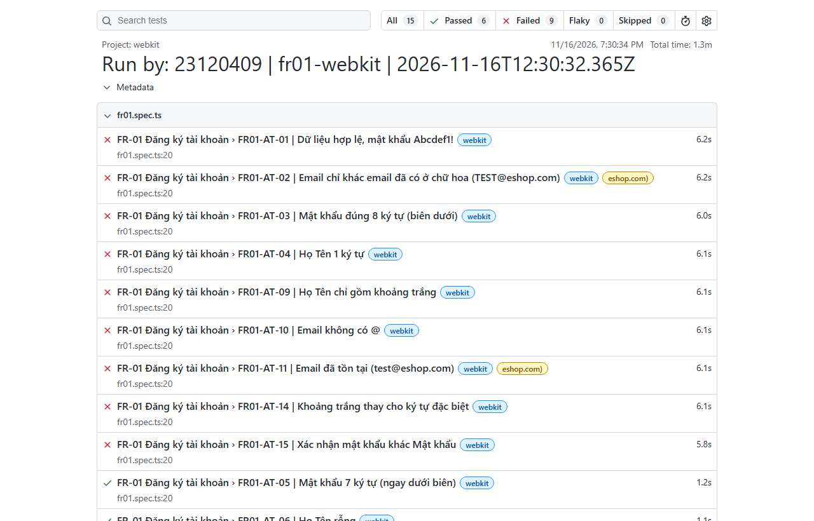
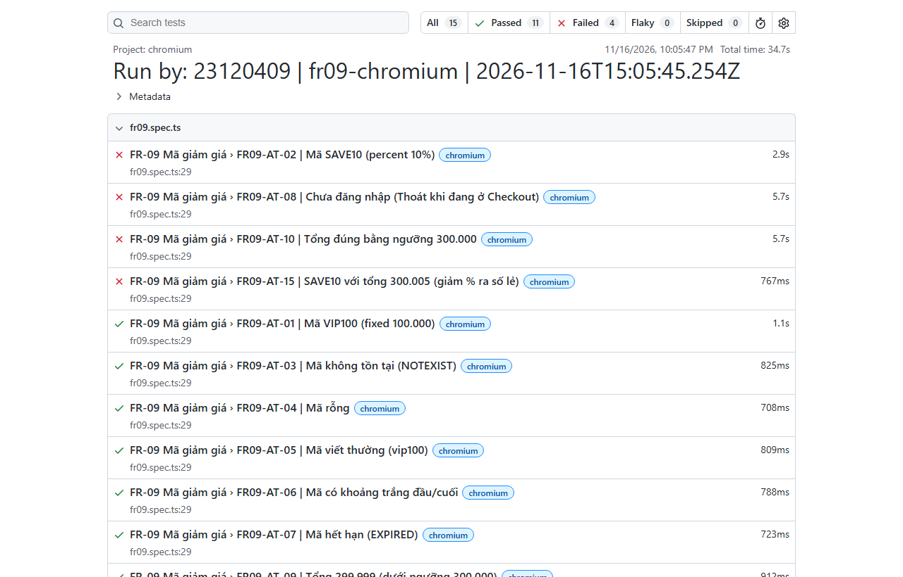
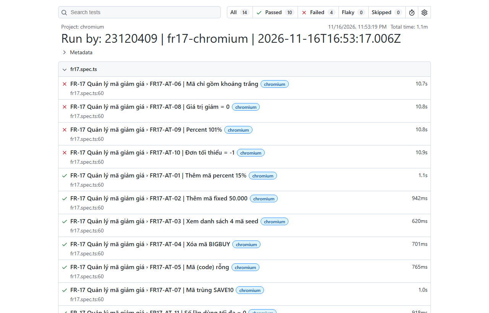
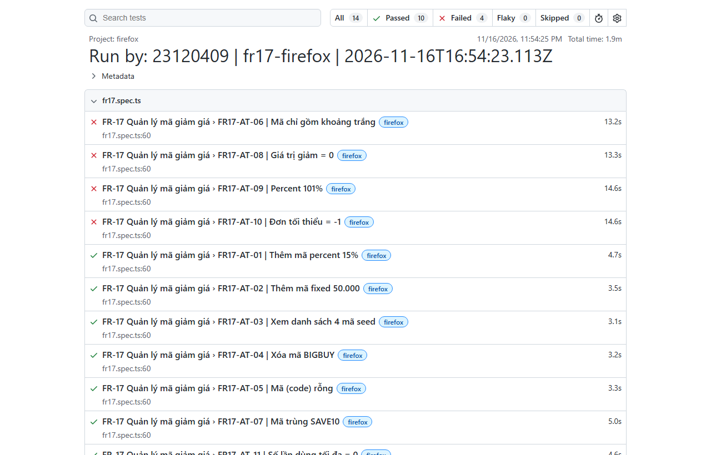
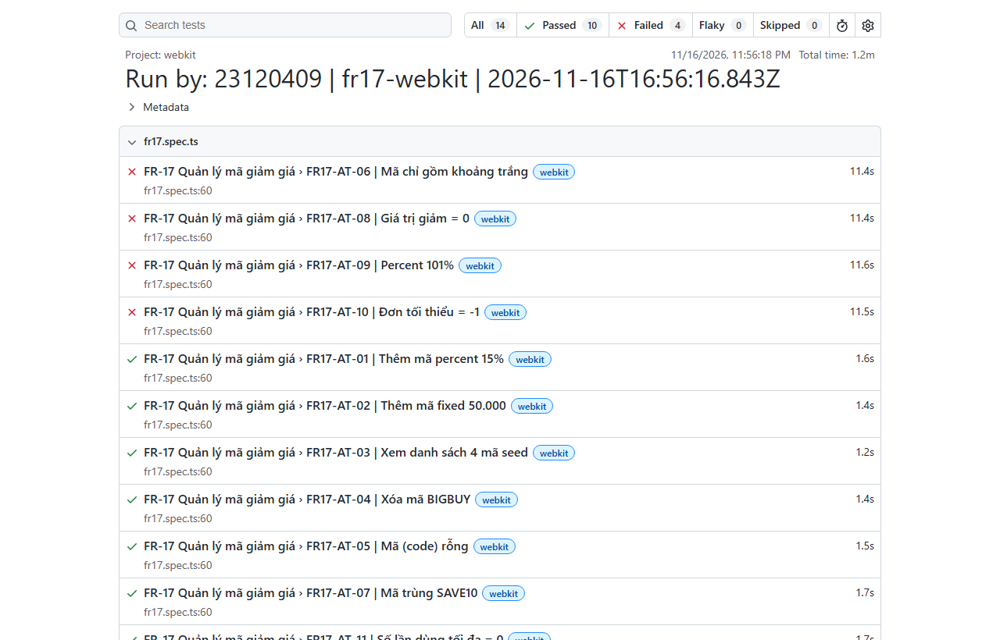

# HW04 — Automation Testing trên EShop

| Thông tin | Nội dung |
| :--- | :--- |
| Họ và tên | NGUYỄN KHẮC VƯỢNG |
| MSSV | 23120409 |
| Lớp | CSC13003 - 23_3 |
| Mã bài tập | HW#04 |
| Ngày hoàn thành báo cáo | 2026-11-17 |
| Repository thực hiện bài | [vinny2707/eshop-sut-HW04](https://github.com/vinny2707/eshop-sut-hw04) (từ [ttbhanh/eshop-sut](https://github.com/ttbhanh/eshop-sut), commit gốc `85af3ba`) |
| Trang GitHub Issues | [vinny2707/eshop-sut-HW04/issues](https://github.com/vinny2707/eshop-sut-hw04/issues) |

## Mục lục

1. [Phạm vi](#1-phạm-vi)
2. [Môi trường và phương pháp](#2-môi-trường-và-phương-pháp)
3. [Pool A — FR-01: Registration](#3-pool-a--fr-01-registration)
4. [Pool B — FR-09: Discount Coupons](#4-pool-b--fr-09-discount-coupons)
5. [Pool C — FR-17: Coupon CRUD](#5-pool-c--fr-17-coupon-crud)
6. [Tổng hợp kết quả](#6-tổng-hợp-kết-quả)
7. [Video demo và Agent Skill](#7-video-demo-và-agent-skill)
8. [Checklist bài nộp](#8-checklist-bài-nộp)

## 1. Phạm vi

| Pool | Tính năng được chọn | Nền tảng | Mục đặc tả |
| :--- | :--- | :--- | :--- |
| A | Registration | Frontend Web | FR-01 |
| B | Discount Coupons | Frontend Web / Checkout | FR-09 |
| C | Coupon CRUD | Web Admin | FR-17 |

Bài làm cá nhân. Ba tính năng trên là ba tính năng web đã chọn ở HW02, không trùng với các thành viên khác trong nhóm. Kết quả mong đợi dựa trên [Đặc tả EShop](../../README.md); test case được chọn từ báo cáo HW02.

## 2. Môi trường và phương pháp

### 2.1. Môi trường

| Thành phần | Chi tiết |
| :-- | :-- |
| SUT | EShop, commit `85af3ba`; Backend Node + Express 5.2.1 + SQLite (`localhost:3000`); Frontend Web React 19.2.6 + Vite 8.0.12 (`localhost:5173`); Web Admin React 19.2.6 + Vite 8.0.12 (`localhost:5174`) |
| Automation | Playwright Test 1.65.1 (TypeScript), Node 24.14.0, Playwright HTML reporter + JSON reporter; mã nguồn ở [`hw04/automation/`](../automation/) |
| Trình duyệt | Chromium 159.0.8154.6 / Firefox 159.0 / WebKit 27.2 (bản đi kèm Playwright 1.65.1) |
| Máy chạy test | Windows 11 Home, PowerShell 5.1 |
| Dữ liệu nền | Playwright tự bật backend, web và admin (`webServer`); backend luôn khởi động mới mỗi lượt chạy nên `backend/database.js` xóa và seed lại DB (2 user, 5 sản phẩm, 4 mã `SAVE10` / `BIGBUY` / `VIP100` / `EXPIRED`); test chạy tuần tự 1 worker vì dùng chung DB. Tài khoản seed: `test@eshop.com` / `Test1234!`, `admin@eshop.com` / `Admin123!` |
| Công cụ AI | Claude Code (Opus 5.5) với 2 Agent Skill tự xây: [`playwright-data-driven`](../skills/playwright-data-driven/SKILL.md), [`ai-audit`](../skills/ai-audit/SKILL.md) |

### 2.2. Thiết kế automation

- **Data-driven:** mỗi FR có một file JSON riêng ([`fr01.json`](../automation/data/fr01.json), [`fr09.json`](../automation/data/fr09.json), [`fr17.json`](../automation/data/fr17.json)); mỗi phần tử là một TC gồm `id`, `source` (TC gốc HW02), `type`, `title`, `note`, `input`, `expected`. Helper [`loadCases()`](../automation/helpers/data.ts) đọc file và thay `{{unique}}` bằng email duy nhất; spec lặp `for (const tc of cases)` để sinh **một test cho mỗi dòng dữ liệu**, tên test là `id | title`, annotation `type` / `note`. Spec và Page Object không chứa dữ liệu test; mọi input và expected lấy từ JSON.
- **Cấu trúc:** Page Object chỉ có locator + thao tác ([`pages/`](../automation/pages/)); spec chia 3 `test.step` Chuẩn bị / Thực hiện / Kiểm tra; trạng thái trước (đăng nhập, user mới, lượt dùng mã) dựng qua API ở bước Chuẩn bị, mọi assertion ở tầng UI.
- **Đa trình duyệt và "Run by":** [`playwright.config.ts`](../automation/playwright.config.ts) có 3 project `chromium`, `firefox`, `webkit`; [`run-all.mjs`](../automation/scripts/run-all.mjs) chạy riêng từng FR × trình duyệt → 9 HTML report ở `reports/<fr>/<browser>/`. `Run by: 23120409 | <fr>-<browser> | <ISO timestamp>` hiển thị ở **tiêu đề report** (option `title` của HTML reporter), ghi trong metadata, và được [`build-dashboard.mjs`](../automation/scripts/build-dashboard.mjs) chép thành `<title>` / `<meta>` dạng chữ thường từ metadata của chính lượt chạy. Khi fail chỉ lưu screenshot + thông báo lỗi; dashboard tổng [`reports/index.html`](../automation/reports/index.html) gom kết quả 9 lượt chạy.

Assertion pattern dùng trong bộ test (mỗi mục FR đánh số AP riêng trong bảng TC của mục đó):

| # | Assertion pattern | Ví dụ | Dùng ở |
| :-- | :-- | :-- | :-- |
| P1 | URL | `expect(page).toHaveURL(/\/login$/)` | FR-01 |
| P2 | Hiển thị / nội dung | `toBeVisible()`, `toContainText(/email/i)` | FR-01, FR-09, FR-17 |
| P3 | Số lượng | `toHaveCount(0)`, `toHaveCount(rowsBefore)` | FR-01, FR-09, FR-17 |
| P4 | Giá trị (poll) | `expect.poll(() => co.money(co.savings)).toBe(…)`, `expect.poll(() => p.rowValues(code)).toEqual(row)` | FR-09, FR-17 |
| P5 | Giá trị ô nhập | `toHaveValue('4000000')` | FR-09 |
| P6 | Validation HTML5 + focus | `el.validationMessage` ≠ rỗng, `toBeFocused()` | FR-01, FR-17 |
| P7 | Trạng thái điều khiển | `toBeDisabled()`, `toBeEnabled()` | FR-09 |
| P8 | Soft assertion | `expect.configure({ soft: true }).poll(() => dialogs.length)` | FR-17 |

### 2.3. AI và human review

Quy trình mỗi FR theo skill `playwright-data-driven`: 4 bước, dừng sau mỗi bước để SV duyệt, ghi audit bằng skill `ai-audit`; bản AI gốc được commit trước khi sửa, mỗi điểm sửa là một commit riêng.

| Giai đoạn | AI làm | Sinh viên làm | Nơi lưu |
| :-- | :-- | :-- | :-- |
| Chọn TC | Đọc HW02 + đặc tả + code UI, đề xuất 12–15 TC và TC không tự động hóa được | Duyệt, bỏ TC trùng (`save10`), chốt expected khi đặc tả không quy định, chốt oracle (kiểm lý do từ chối) | Mục 3.1 / 4.1 / 5.1; AUDIT-02, 06, 10 |
| Khảo sát UI + data | Đề xuất selector, điểm dễ flaky, sinh file JSON | Sửa thiết kế (so dòng bằng `allInnerTexts`, chờ bảng tải, đóng dialog), chốt cô lập dữ liệu (user mới mỗi test, thứ tự chạy) | `data/*.json`; AUDIT-03, 07, 11 |
| Sinh script | Sinh Page Object + spec theo template, chạy 3 trình duyệt, phân loại fail, đưa checklist | Commit bản AI gốc, review code và screenshot | `pages/`, `tests/`; AUDIT-04, 08, 12 |
| Chạy và sửa | Sửa đúng các điểm SV nêu, chạy lại, tách commit | Phát hiện lỗi script (bỏ qua lặng lẽ, data sai vẫn pass, mất bằng chứng, ảnh thiếu mã sai), quyết định cách sửa | Mục 3.4 / 4.4 / 5.4; commit `test(frXX)` |
| Báo cáo và audit | Nháp báo cáo, bug report, đăng GitHub Issue, chụp evidence, ghi audit | Đọc lại, quyết định verdict, mã bug và cách gộp bug | `reports/`, `evidence/`, Issue #1–#12 |

## 3. Pool A — FR-01: Registration

Script: [`tests/fr01.spec.ts`](../automation/tests/fr01.spec.ts), [`pages/RegisterPage.ts`](../automation/pages/RegisterPage.ts) · Data: [`data/fr01.json`](../automation/data/fr01.json)

### 3.1. Test case tự động hóa

15 TC chọn từ 34 TC của HW02 (1 Positive, 4 Edge, 10 Negative). Kết quả ghi theo thứ tự **Chromium / Firefox / WebKit**.

Quy ước oracle: thành công → chuyển tới `/login`; bị từ chối → ở lại `/register` **và** thông báo lỗi nêu đúng trường bị sai. Đặc tả không quy định nội dung thông báo, nên "nêu đúng trường" được kiểm bằng từ khóa (`tên`, `email`, `mật khẩu`, `xác nhận`, không phân biệt hoa/thường) — đây là quy ước của bài, không phải yêu cầu đặc tả. Trường bắt buộc để trống → trình duyệt chặn bằng validation HTML5.

| TC ID | Nguồn TC | Loại | Mô tả | Expected | Assertion | Kết quả | Bug ID |
| :-- | :-- | :-- | :-- | :-- | :-- | :-- | :-- |
| FR01-AT-01 | FR01-TC-01 | Positive | Dữ liệu hợp lệ, mật khẩu `Abcdef1!` | Chuyển tới `/login` | AP-01 | Fail / Fail / Fail | BUG-FR01-01 |
| FR01-AT-02 | FR01-TC-16 | Edge | Email `TEST@eshop.com` (khác `test@` ở chữ hoa) | Chuyển tới `/login` — *đặc tả không quy định phân biệt hoa/thường email; expected theo quyết định HW02 (gap #6)* | AP-01 | Fail / Fail / Fail | BUG-FR01-01 |
| FR01-AT-03 | FR01-TC-31 | Edge | Mật khẩu đúng 8 ký tự `ABcd12@$` | Chuyển tới `/login` | AP-01 | Fail / Fail / Fail | BUG-FR01-01 |
| FR01-AT-04 | FR01-TC-29 | Edge | Họ Tên 1 ký tự `A` | Chuyển tới `/login` | AP-01 | Fail / Fail / Fail | BUG-FR01-01 |
| FR01-AT-05 | FR01-TC-17 | Edge | Mật khẩu 7 ký tự `Abcde1!` | Từ chối, lỗi về mật khẩu | AP-02, AP-01 | Pass (che khuất) ×3 | BUG-FR01-01 |
| FR01-AT-06 | FR01-TC-08 | Negative | Họ Tên rỗng | Trình duyệt chặn ở ô Họ Tên | AP-03, AP-05, AP-04, AP-01 | Pass / Pass / Pass | — |
| FR01-AT-07 | FR01-TC-10 | Negative | Email rỗng | Trình duyệt chặn ở ô Email | AP-03, AP-05, AP-04, AP-01 | Pass / Pass / Pass | — |
| FR01-AT-08 | FR01-TC-18 | Negative | Mật khẩu rỗng | Trình duyệt chặn ở ô Mật khẩu | AP-03, AP-05, AP-04, AP-01 | Pass / Pass / Pass | — |
| FR01-AT-09 | FR01-TC-09 | Negative | Họ Tên chỉ gồm khoảng trắng | Từ chối, lỗi về Họ Tên | AP-02, AP-01 | Fail / Fail / Fail | BUG-FR01-04 |
| FR01-AT-10 | FR01-TC-11 | Negative | Email không có `@` | Từ chối, lỗi về email | AP-02, AP-01 | Fail / Fail / Fail | BUG-FR01-05 |
| FR01-AT-11 | FR01-TC-15 | Negative | Email đã tồn tại `test@eshop.com` | Từ chối, lỗi về email | AP-02, AP-01 | Fail / Fail / Fail | BUG-FR01-06 |
| FR01-AT-12 | FR01-TC-19 | Negative | Mật khẩu không có chữ hoa `abcdef1!` | Từ chối, lỗi về mật khẩu | AP-02, AP-01 | Pass (che khuất) ×3 | BUG-FR01-01 |
| FR01-AT-13 | FR01-TC-22 | Negative | Mật khẩu không có ký tự đặc biệt `Abcdefg1` | Từ chối, lỗi về mật khẩu | AP-02, AP-01 | Pass (che khuất) ×3 | BUG-FR01-01 |
| FR01-AT-14 | FR01-TC-24 | Negative | Khoảng trắng thay ký tự đặc biệt `Abcdef 1` | Từ chối, lỗi về mật khẩu | AP-02, AP-01 | Fail / Fail / Fail | BUG-FR01-02 |
| FR01-AT-15 | FR01-TC-25 | Negative | Xác nhận mật khẩu khác Mật khẩu | Có ô Xác nhận; từ chối, lỗi về xác nhận | AP-02 | Fail / Fail / Fail | BUG-FR01-03 |

Assertion pattern dùng trong FR-01: **AP-01** `toHaveURL`, **AP-02** `toBeVisible` / `toContainText`, **AP-03** `validationMessage` (HTML5), **AP-04** `toHaveCount`, **AP-05** `toBeFocused`.

**Pass (che khuất):** regex mật khẩu ở UI từ chối mọi mật khẩu không có khoảng trắng với cùng một thông báo, nên AT-05, 12, 13 pass mà không chứng minh được UI kiểm đúng luật độ dài / chữ hoa / ký tự đặc biệt (BUG-FR01-01). Ghi chú này hiện trong report và dashboard qua annotation `note`.

TC không tự động hóa được / không chọn:

| TC HW02 | Lý do |
| :-- | :-- |
| TC-02…07 | Chỉ đổi ký tự đặc biệt, cùng luồng với AT-01 |
| TC-12, 13, 14 | Lỗi định dạng email cùng nhóm với AT-10 |
| TC-20, 21, 23 | Mật khẩu thiếu một loại ký tự, cùng nhóm với AT-12, AT-13 |
| TC-26 | Xác nhận mật khẩu rỗng — form không có ô này, AT-15 đã phủ |
| TC-27, 28, 30, 32, 33, 34 | Điểm biên BVA trùng nhóm với TC đã chọn |
| Phần "không tạo user" của expected | Không quan sát được ở tầng UI; TC thành công chỉ kiểm điều hướng tới `/login`, không đăng nhập lại để xác nhận tài khoản |
| Phần "từ chối khi hai mật khẩu khác nhau" của AT-15 | Không thực thi được vì form không có ô Xác nhận mật khẩu |

### 3.2. Kết quả chạy

| Trình duyệt | Thời điểm chạy (ISO) | Tổng | Pass | Fail | HTML report |
| :-- | :-- | :-- | :-- | :-- | :-- |
| Chromium | 2026-11-16T12:47:44.000Z | 15 | 6 | 9 | [fr01/chromium](../automation/reports/fr01/chromium/index.html) |
| Firefox | 2026-11-16T12:28:21.184Z | 15 | 6 | 9 | [fr01/firefox](../automation/reports/fr01/firefox/index.html) |
| WebKit | 2026-11-16T12:30:32.365Z | 15 | 6 | 9 | [fr01/webkit](../automation/reports/fr01/webkit/index.html) |

Ba trình duyệt cho cùng kết quả trên từng TC. Dashboard tổng: [reports/index.html](../automation/reports/index.html).

Ảnh chụp 3 HTML report, tiêu đề hiển thị "Run by: 23120409" kèm ISO timestamp của lượt chạy:

### 3.3. Bug phát hiện

| Bug ID | Tiêu đề | Severity | TC phát hiện | GitHub Issue |
| :-- | :-- | :-- | :-- | :-- |
| BUG-FR01-01 | Mật khẩu hợp lệ theo đặc tả bị từ chối (regex bắt buộc khoảng trắng, cấm ký tự đặc biệt) | Critical | AT-01, 02, 03, 04 (che khuất AT-05, 12, 13) | [#1](https://github.com/vinny2707/eshop-sut-hw04/issues/1) |
| BUG-FR01-02 | Chấp nhận mật khẩu dùng khoảng trắng thay ký tự đặc biệt và tạo tài khoản | High | AT-14 | [#2](https://github.com/vinny2707/eshop-sut-hw04/issues/2) |
| BUG-FR01-03 | Form đăng ký không có trường Xác nhận mật khẩu | Medium | AT-15 | [#3](https://github.com/vinny2707/eshop-sut-hw04/issues/3) |
| BUG-FR01-04 | Không báo lỗi Họ Tên chỉ gồm khoảng trắng | Medium | AT-09 | [#4](https://github.com/vinny2707/eshop-sut-hw04/issues/4) |
| BUG-FR01-05 | Không báo lỗi email sai định dạng | Medium | AT-10 | [#5](https://github.com/vinny2707/eshop-sut-hw04/issues/5) |
| BUG-FR01-06 | Không báo lỗi email đã tồn tại | High | AT-11 | [#6](https://github.com/vinny2707/eshop-sut-hw04/issues/6) |

Chi tiết: [bug_report.md](bug_report.md#fr-01--registration)

### 3.4. AI gap analysis

| # | AI bỏ sót / làm sai | Loại | Nguyên nhân | Xử lý | Commit | Audit |
| :-- | :-- | :-- | :-- | :-- | :-- | :-- |
| 1 | Bộ TC ban đầu không cảnh báo AT-05, 12, 13 sẽ pass sai lý do (regex mật khẩu sai che khuất) | Assertion | **Đặc điểm tính năng:** một regex sai chặn mọi mật khẩu với cùng thông báo; AI chỉ nêu khi SV hỏi lại | Giữ TC, ghi "Pass (che khuất)" trong data, report và báo cáo | Không có commit riêng | AUDIT-02 |
| 2 | Expected AT-02 (email khác hoa/thường) trình bày như yêu cầu đặc tả | Edge case | **Giới hạn AI:** lấy kết luận của HW02 làm căn cứ mà không tách khỏi đặc tả | Ghi rõ căn cứ là quyết định HW02 (gap #6) | Không có commit riêng | AUDIT-02 |
| 3 | Test trường rỗng (AT-06…08) chỉ kiểm `validationMessage` ≠ rỗng — luôn đúng với ô trống — và `toHaveCount(0)` kiểm ngay, không chờ | Assertion / Wait | **Giới hạn AI:** chọn assertion dễ viết thay vì hành vi quan sát được chứng minh form không được gửi | Thêm `toBeFocused()` lên ô lỗi trước `toHaveCount(0)` | | AUDIT-04 |
| 4 | Trường `note` (che khuất) có trong data nhưng spec không đọc → report hiện Pass như bình thường | Assertion | **Prompt:** template chỉ quy định annotation `type` | Thêm annotation `note`; dashboard hiển thị ghi chú | | AUDIT-04 |
| 5 | Các `expect` không có mô tả → lỗi khó chẩn đoán (AT-14 chỉ báo `toBeVisible() failed`, không nói trang đã chuyển `/login`) | Assertion | **Prompt:** template không yêu cầu thông điệp cho assertion | Thêm mô tả cho mọi `expect` theo expected của đặc tả | | AUDIT-04 |

## 4. Pool B — FR-09: Discount Coupons

Script: [`tests/fr09.spec.ts`](../automation/tests/fr09.spec.ts), [`pages/ShopPage.ts`](../automation/pages/ShopPage.ts), [`pages/CheckoutPage.ts`](../automation/pages/CheckoutPage.ts), [`helpers/auth.ts`](../automation/helpers/auth.ts) · Data: [`data/fr09.json`](../automation/data/fr09.json)

### 4.1. Test case tự động hóa

15 TC chọn từ 25 TC của HW02 (2 Positive, 7 Edge, 6 Negative), phủ C1–C5, 2 loại mã, biên C3, biên C5 và làm tròn %. Kết quả ghi theo thứ tự **Chromium / Firefox / WebKit**.

**Chuẩn bị (qua API, không phải assertion):** mỗi test đăng ký một user mới rồi đăng nhập (token ghi vào `localStorage` trước khi mở trang), nên lượt dùng mã không dồn giữa các test; AT-12, 13, 14 ghi sẵn lượt đã dùng bằng `POST /api/coupon-usage`. Sau đó thêm 1 × "Bàn phím cơ Keychron Q1" (4.000.000 ₫) ở Trang chủ và đi tới Checkout bằng click (giỏ hàng chỉ nằm trong bộ nhớ React). Test chờ header hiện "Chào, …" trước khi thao tác, vì nếu `user` chưa tải xong thì `user_id` gửi đi là `null` và C5 bị bỏ qua.

**Quy ước oracle:** áp dụng được → hiện thông báo thành công, số tiền giảm, thành tiền và tổng thanh toán đúng công thức FR-09; bị từ chối → thông báo lỗi **nêu đúng điều kiện vi phạm** (từ khóa `không tồn tại` C1, `hết hạn` C2, `tối thiểu` C3, `đăng nhập` C4, `giới hạn` C5 — quy ước của bài, đặc tả không quy định câu chữ), không có kết quả giảm, tổng giữ nguyên. Số tiền được tách chữ số trước khi so (không phụ thuộc locale).

| TC ID | Nguồn TC | Loại | Mô tả | Expected | Assertion | Kết quả | Bug ID |
| :-- | :-- | :-- | :-- | :-- | :-- | :-- | :-- |
| FR09-AT-01 | FR09-TC-02 | Positive | `VIP100` (fixed) | Giảm 100.000, thành tiền 3.900.000 | AP-03, AP-04 | Pass / Pass / Pass | — |
| FR09-AT-02 | FR09-TC-01 | Positive | `SAVE10` (percent 10%) | Giảm 400.000, thành tiền 3.600.000 | AP-03, AP-04 | Fail / Fail / Fail | BUG-FR09-01 |
| FR09-AT-03 | FR09-TC-03 | Negative | Mã không tồn tại `NOTEXIST` | Từ chối (C1), tổng giữ 4.000.000 | AP-03, AP-04, AP-05 | Pass / Pass / Pass | — |
| FR09-AT-04 | FR09-TC-04 | Negative | Mã rỗng | Nút "Áp dụng" bị vô hiệu hóa — *đặc tả không quy định; theo quyết định HW02* | AP-02, AP-04, AP-05 | Pass / Pass / Pass | — |
| FR09-AT-05 | FR09-TC-06 | Edge | Mã viết thường `vip100` | Như AT-01 | AP-03, AP-04 | Pass / Pass / Pass | — |
| FR09-AT-06 | FR09-TC-07 | Edge | Mã có khoảng trắng đầu/cuối | Như AT-01 | AP-03, AP-04 | Pass / Pass / Pass | — |
| FR09-AT-07 | FR09-TC-08 | Negative | Mã hết hạn `EXPIRED` | Từ chối (C2) | AP-03, AP-04, AP-05 | Pass / Pass / Pass | — |
| FR09-AT-08 | FR09-TC-10 | Negative | Bấm "Thoát" khi đang ở Checkout rồi áp `VIP100` | Từ chối (C4) — *Checkout vẫn hiện sau khi thoát là lỗi FR-08, ngoài phạm vi* | AP-03 | Fail / Fail / Fail | BUG-FR09-03 |
| FR09-AT-09 | FR09-TC-13 | Edge | Tổng 299.999 | Từ chối (C3) | AP-03, AP-04, AP-05 | Pass / Pass / Pass | — |
| FR09-AT-10 | FR09-TC-14 | Edge | Tổng đúng bằng 300.000 | Giảm 100.000, thành tiền 200.000 | AP-03, AP-04 | Fail / Fail / Fail | BUG-FR09-02 |
| FR09-AT-11 | FR09-TC-15 | Edge | Tổng 300.001 | Giảm 100.000, thành tiền 200.001 | AP-03, AP-04 | Pass / Pass / Pass | — |
| FR09-AT-12 | FR09-TC-19 | Edge | Đã dùng `VIP100` 1 lần (giới hạn 2) | Như AT-01 | AP-03, AP-04 | Pass / Pass / Pass | — |
| FR09-AT-13 | FR09-TC-12 | Negative | Đã dùng `VIP100` 2 lần | Từ chối (C5) | AP-03, AP-04, AP-05 | Pass / Pass / Pass | — |
| FR09-AT-14 | FR09-TC-20 | Negative | Đã dùng `SAVE10` 1 lần (giới hạn 1) | Từ chối (C5) | AP-03, AP-04, AP-05 | Pass / Pass / Pass | — |
| FR09-AT-15 | FR09-TC-21 | Edge | `SAVE10` với tổng 300.005 | Giảm 30.000–30.001 — *đặc tả không quy định làm tròn; theo HW02* | AP-03, AP-04 | Fail / Fail / Fail | BUG-FR09-01 |

Assertion pattern dùng trong FR-09: **AP-02** `toBeDisabled` / `toBeEnabled`, **AP-03** `toBeVisible` / `toHaveCount` / `toContainText`, **AP-04** `expect.poll` trên giá trị số (số tiền giảm, thành tiền, tổng thanh toán), **AP-05** `toHaveValue` (ô tổng tiền).

**Ô tổng tiền:** AT-09, 10, 11, 15 nhập tổng vào ô "Tổng tiền thanh toán" ở Checkout, vì sản phẩm rẻ nhất trong seed là 4.000.000 ₫. Ô này sửa được là lỗi của FR-08 (ngoài phạm vi FR-09), không ghi thành bug FR-09.

TC không tự động hóa được / không chọn:

| TC HW02 | Lý do |
| :-- | :-- |
| TC-05 (`is_active = 0`) | Cần sửa DB; UI và API không có chức năng vô hiệu hóa mã |
| TC-11 (token sai), TC-24, TC-25 (`user_id`) | Chỉ kiểm được ở tầng API |
| TC-16, 17, 18 (hạn dùng hôm qua / hôm nay / ngày mai) | Cần sửa `expired_at` trong DB; TC-17 còn phụ thuộc giờ chạy |
| TC-22, 23 (mã thử `FIX500`) | Cần tạo mã mới, thuộc FR-17 |
| TC-09 (tổng 200.000) | Trùng nhóm với AT-09 |

### 4.2. Kết quả chạy

| Trình duyệt | Thời điểm chạy (ISO) | Tổng | Pass | Fail | HTML report |
| :-- | :-- | :-- | :-- | :-- | :-- |
| Chromium | 2026-11-16T15:05:45.254Z | 15 | 11 | 4 | [fr09/chromium](../automation/reports/fr09/chromium/index.html) |
| Firefox | 2026-11-16T15:06:21.976Z | 15 | 11 | 4 | [fr09/firefox](../automation/reports/fr09/firefox/index.html) |
| WebKit | 2026-11-16T15:07:44.352Z | 15 | 11 | 4 | [fr09/webkit](../automation/reports/fr09/webkit/index.html) |

Ba trình duyệt cho cùng kết quả trên từng TC. Dashboard tổng: [reports/index.html](../automation/reports/index.html).

Ảnh chụp 3 HTML report, tiêu đề hiển thị "Run by: 23120409" kèm ISO timestamp của lượt chạy:

### 4.3. Bug phát hiện

| Bug ID | Tiêu đề | Severity | TC phát hiện | GitHub Issue |
| :-- | :-- | :-- | :-- | :-- |
| BUG-FR09-01 | Mã giảm % cho số tiền giảm âm, thành tiền tăng gấp nhiều lần | Critical | AT-02, AT-15 | [#7](https://github.com/vinny2707/eshop-sut-hw04/issues/7) |
| BUG-FR09-02 | Tổng đơn đúng bằng ngưỡng tối thiểu bị từ chối | Medium | AT-10 | [#8](https://github.com/vinny2707/eshop-sut-hw04/issues/8) |
| BUG-FR09-03 | Áp dụng được mã khi chưa đăng nhập | High | AT-08 | [#9](https://github.com/vinny2707/eshop-sut-hw04/issues/9) |

Chi tiết: [bug_report.md](bug_report.md#fr-09--discount-coupons)

### 4.4. AI gap analysis

| # | AI bỏ sót / làm sai | Loại | Nguyên nhân | Xử lý | Commit | Audit |
| :-- | :-- | :-- | :-- | :-- | :-- | :-- |
| 1 | Khảo sát UI ban đầu không nêu rủi ro `user` tải chậm làm `user_id = null`, C5 bị bỏ qua (AT-13, 14 có thể fail sai) | Wait | **Đặc điểm tính năng:** AuthContext tải `user` bất đồng bộ sau khi đọc token; AI chỉ nêu khi SV hỏi lại | Chờ header "Chào, …" trước khi thao tác | `1f566b9` (có sẵn trong bản AI, SV chốt ở bước 2) | AUDIT-07 |
| 2 | `applyIfEnabled()` dùng `isEnabled()` không chờ; nút tắt ngoài dự kiến thì bỏ qua lặng lẽ, test fail ở bước Kiểm tra với nguyên nhân sai | Wait / Assertion | **Giới hạn AI:** gộp một luồng cho mọi TC nên chọn bỏ qua thay vì fail đúng chỗ | Quyết định theo input: đã nhập mã thì `toBeEnabled()` rồi bấm | `5287e2d` | AUDIT-08 |
| 3 | Comment trong `CheckoutPage.ts` nhắc hàm `applyCode` không tồn tại | Khác | **Giới hạn AI:** đổi tên hàm khi viết code mà không đồng bộ comment | Sửa comment theo hàm `apply()` | `5287e2d` | AUDIT-08 |
| 4 | Nhận diện thông báo thành công bằng emoji `✅` | Selector | **Giới hạn AI:** chọn ký tự đầu dòng dễ khớp thay vì nội dung có nghĩa | Đổi sang `getByText(/Áp dụng thành công/)` | `706645a` | AUDIT-08 |
| 5 | `expect(allowed).toContain(discount)` đặt ngược vế → report đảo nhãn Expected / Received | Assertion | **Giới hạn AI:** dùng `toContain` cho tập giá trị cho phép mà không xét cách Playwright in lỗi | Kiểm theo khoảng `toBeGreaterThanOrEqual` / `toBeLessThanOrEqual`, một giá trị dùng `toBe` | `7e1bac0` | AUDIT-08 |
| 6 | Nhánh bị từ chối chỉ kiểm "có thông báo lỗi", không kiểm lý do (C1/C2/C3/C5) → có thể pass sai lý do; mô tả "Mã không hợp lệ" sai nghĩa với AT-08 | Assertion | **Giới hạn AI:** không áp lại bài học che khuất của FR-01 khi sinh oracle cho FR mới | Thêm `expected.reason` (từ khóa theo C1–C5) và `toContainText`; mô tả nêu lý do | `24926c4` | AUDIT-08 |

## 5. Pool C — FR-17: Coupon CRUD

Script: [`tests/fr17.spec.ts`](../automation/tests/fr17.spec.ts), [`pages/AdminCouponPage.ts`](../automation/pages/AdminCouponPage.ts), [`helpers/auth.ts`](../automation/helpers/auth.ts) · Data: [`data/fr17.json`](../automation/data/fr17.json)

### 5.1. Test case tự động hóa

14 TC chọn từ 36 TC của HW02 (4 Positive, 7 Negative, 3 Edge), phủ Thêm / Xem / Xóa (đặc tả FR-17 không có Sửa), các trường bắt buộc và biên chính. Kết quả ghi theo thứ tự **Chromium / Firefox / WebKit**.

**Chuẩn bị:** đăng nhập admin seed qua API (`localStorage["adminToken"]`, không phải assertion), mở Web Admin `http://localhost:5174`, tab "Mã Giảm Giá", chờ dòng `SAVE10` hiện (bảng tải xong) rồi mới đếm số dòng. Mỗi TC Thêm dùng một mã riêng `CPnn`. Spec kiểm data trước khi chạy (`validateCase`): data thiếu trường / gõ sai thì fail ngay.

**Quy ước oracle:** Thêm thành công → đúng 1 dòng mang mã đó, 6 ô hiển thị đúng giá trị (số đã bỏ dấu phân cách theo locale); bị từ chối → trình duyệt chặn (validation HTML5 + focus vào ô lỗi) hoặc app báo lỗi bằng `alert`, **và** số dòng của bảng giữ nguyên. Đặc tả không quy định nội dung thông báo lỗi, nên chỉ kiểm có thông báo.

| TC ID | Nguồn TC | Loại | Mô tả | Expected | Assertion | Kết quả | Bug ID |
| :-- | :-- | :-- | :-- | :-- | :-- | :-- | :-- |
| FR17-AT-01 | FR17-TC-01 | Positive | Thêm mã percent 15% | 1 dòng: Phần trăm, 15%, 200.000 ₫, 2099-12-31, 1 lần | AP-04, AP-03 | Pass / Pass / Pass | — |
| FR17-AT-02 | FR17-TC-02 | Positive | Thêm mã fixed 50.000 | 1 dòng: Cố định, 50.000 ₫ | AP-04, AP-03 | Pass / Pass / Pass | — |
| FR17-AT-03 | FR17-TC-03 | Positive | Xem danh sách | Đủ 4 mã seed, mỗi dòng đủ 6 cột | AP-04 | Pass / Pass / Pass | — |
| FR17-AT-04 | FR17-TC-04 | Positive | Xóa `BIGBUY` | `BIGBUY` biến mất, 3 mã seed còn lại nguyên — *dựa vào thứ tự chạy tuần tự (AT-03 trước AT-04)* | AP-03, AP-02 | Pass / Pass / Pass | — |
| FR17-AT-05 | FR17-TC-05 | Negative | Mã rỗng | Trình duyệt chặn ở ô mã, không tạo | AP-05, AP-03 | Pass / Pass / Pass | — |
| FR17-AT-06 | FR17-TC-06 | Negative | Mã chỉ gồm khoảng trắng | Có thông báo lỗi, không tạo | AP-01, AP-03 | Fail / Fail / Fail | BUG-FR17-01 |
| FR17-AT-07 | FR17-TC-07 | Negative | Mã trùng `SAVE10` | Có thông báo lỗi, không tạo thêm | AP-01, AP-03 | Pass / Pass / Pass | — |
| FR17-AT-08 | FR17-TC-11 | Negative | Giá trị giảm = 0 | Có thông báo lỗi, không tạo (giá trị phải dương) | AP-01, AP-03 | Fail / Fail / Fail | BUG-FR17-02 |
| FR17-AT-09 | FR17-TC-14 | Negative | Percent 101% | Có thông báo lỗi, không tạo — *% ≤ 100 theo quyết định HW02* | AP-01, AP-03 | Fail / Fail / Fail | BUG-FR17-02 |
| FR17-AT-10 | FR17-TC-18 | Negative | Đơn tối thiểu = −1 | Có thông báo lỗi, không tạo (≥ 0) | AP-01, AP-03 | Fail / Fail / Fail | BUG-FR17-03 |
| FR17-AT-11 | FR17-TC-20 | Negative | Số lần dùng tối đa = 0 | Trình duyệt chặn ở ô số lần, không tạo (≥ 1) | AP-05, AP-03 | Pass / Pass / Pass | — |
| FR17-AT-12 | FR17-TC-17 | Edge | Hạn dùng 2020-01-01 (quá khứ) | Tạo được, cột Hết hạn hiện "Hết hạn" — *đặc tả không cấm; theo HW02* | AP-04, AP-03 | Pass / Pass / Pass | — |
| FR17-AT-13 | FR17-TC-31 | Edge | Percent 100% (biên trên) | Tạo được, hiện 100% | AP-04, AP-03 | Pass / Pass / Pass | — |
| FR17-AT-14 | FR17-TC-32 | Edge | Đơn tối thiểu = 0 (biên dưới) | Tạo được, hiện 0 ₫ | AP-04, AP-03 | Pass / Pass / Pass | — |

Assertion pattern dùng trong FR-17: **AP-01** `expect.poll` (soft) trên số `alert` của app, **AP-02** `toBeVisible`, **AP-03** `toHaveCount` (dòng của mã / tổng số dòng), **AP-04** `expect.poll(...).toEqual` trên 6 ô của dòng, **AP-05** `validationMessage` + `toBeFocused`.

TC không tự động hóa được / không chọn:

| TC HW02 | Lý do |
| :-- | :-- |
| TC-08 (`save10`) | Ô mã tự viết hoa nên ở UI trùng đường đi với AT-07; khác hoa/thường chỉ kiểm được ở tầng API |
| TC-22, 23, 24 (user thường thêm / xóa / xem) | Chỉ kiểm được ở tầng API (FR-12); trang Admin chặn user thường ở phía trình duyệt |
| TC-09, 10, 13, 16, 19, 21 (loại ngoài tập / thiếu, giá trị `"abc"`, ngày sai, thiếu trường) | Chỉ kiểm được ở tầng API — UI dùng `select`, `type=number`, `type=date` |
| TC-25, 26 (không có / sai token) | Chỉ kiểm được ở tầng API |
| TC-12, 15 (giá trị / hạn rỗng) | Cùng cơ chế `required` với AT-05 |
| TC-27 (giá trị −1) | Cùng nhóm với AT-08 |
| TC-28, 29, 30, 33, 34, 35, 36 | Điểm biên trùng nhóm hoặc không thêm thông tin |

### 5.2. Kết quả chạy

| Trình duyệt | Thời điểm chạy (ISO) | Tổng | Pass | Fail | HTML report |
| :-- | :-- | :-- | :-- | :-- | :-- |
| Chromium | 2026-11-16T16:53:17.006Z | 14 | 10 | 4 | [fr17/chromium](../automation/reports/fr17/chromium/index.html) |
| Firefox | 2026-11-16T16:54:23.113Z | 14 | 10 | 4 | [fr17/firefox](../automation/reports/fr17/firefox/index.html) |
| WebKit | 2026-11-16T16:56:16.843Z | 14 | 10 | 4 | [fr17/webkit](../automation/reports/fr17/webkit/index.html) |

Ba trình duyệt cho cùng kết quả trên từng TC. Mỗi TC fail báo 2 lỗi: không có thông báo lỗi **và** số dòng tăng thêm 1 (mã sai đã được lưu). Dashboard tổng: [reports/index.html](../automation/reports/index.html).

Ảnh chụp 3 HTML report, tiêu đề hiển thị "Run by: 23120409" kèm ISO timestamp của lượt chạy:

### 5.3. Bug phát hiện

| Bug ID | Tiêu đề | Severity | TC phát hiện | GitHub Issue |
| :-- | :-- | :-- | :-- | :-- |
| BUG-FR17-01 | Tạo được mã chỉ gồm khoảng trắng | Medium | AT-06 | [#10](https://github.com/vinny2707/eshop-sut-hw04/issues/10) |
| BUG-FR17-02 | Tạo được mã có giá trị giảm 0 hoặc trên 100% | High | AT-08, AT-09 | [#11](https://github.com/vinny2707/eshop-sut-hw04/issues/11) |
| BUG-FR17-03 | Tạo được mã có đơn tối thiểu âm | Medium | AT-10 | [#12](https://github.com/vinny2707/eshop-sut-hw04/issues/12) |

Chi tiết: [bug_report.md](bug_report.md#fr-17--coupon-crud)

### 5.4. AI gap analysis

| # | AI bỏ sót / làm sai | Loại | Nguyên nhân | Xử lý | Commit | Audit |
| :-- | :-- | :-- | :-- | :-- | :-- | :-- |
| 1 | Giữ TC `save10` dù ô mã tự viết hoa → ở UI trùng đường đi với AT-07 | Edge case | **Giới hạn AI:** chọn theo danh sách TC của HW02, không xét hành vi UI đã khảo sát | Bỏ TC, ghi vào bảng không chọn | — (bước chọn TC, data `bf98b4f`) | AUDIT-10 |
| 2 | Đề xuất so dòng bằng `toHaveText([...6 ô])` — dòng có 7 ô và không bỏ được dấu phân cách số | Assertion | **Giới hạn AI:** không đối chiếu số cột thật và định dạng locale | Đọc 6 ô đầu bằng `allInnerTexts()`, chuẩn hóa số, so trong `expect.poll` | `bf98b4f` (áp dụng trước khi sinh code) | AUDIT-11 |
| 3 | Đếm số dòng ngay khi heading "EShop Admin" hiện — bảng có thể chưa tải xong | Wait | **Đặc điểm tính năng:** sidebar render trước khi `fetchData()` trả về | Chờ dòng `SAVE10` hiện rồi mới đếm | `bf98b4f` (áp dụng trước khi sinh code) | AUDIT-11 |
| 4 | Bắt `alert` bằng `waitForEvent('dialog')` nhưng không đóng — trang bị chặn | Wait | **Giới hạn AI:** không xét việc Playwright không tự đóng dialog khi đã có listener | Ghi nội dung rồi `dialog.accept()` | `bf98b4f` (áp dụng trước khi sinh code) | AUDIT-11 |
| 5 | AT-04 đề xuất tạo mã qua API vì đánh giá quá cao rủi ro phụ thuộc thứ tự | Edge case | **Giới hạn AI:** không đối chiếu cấu hình chạy tuần tự (`workers: 1`) và việc reset DB mỗi lần chạy | Xóa `BIGBUY` như HW02, ghi chú phụ thuộc thứ tự | `bf98b4f` (data AT-04) | AUDIT-11 |
| 6 | Các nhánh kiểm tra có điều kiện phụ `&& expected.row`, `&& input.code`… → data thiếu trường / `outcome` gõ sai thì test pass mà không kiểm gì | Assertion | **Giới hạn AI:** viết điều kiện phòng thủ khiến nhánh im lặng bỏ qua thay vì báo lỗi data | `validateCase()` kiểm data đầu mỗi test, bỏ điều kiện phụ | `a8dd8aa` | AUDIT-12 |
| 7 | Kiểm thông báo lỗi bằng assertion bắt buộc → fail là dừng, report không ghi bằng chứng mã sai đã được tạo | Assertion | **Giới hạn AI:** không xét giá trị bằng chứng của các assertion sau | Kiểm thông báo bằng `expect.configure({ soft: true }).poll`, vẫn kiểm số dòng | `59d06a9` | AUDIT-12 |
| 8 | Comment `row(code)` ghi "ô đầu" nhưng locator khớp bất kỳ ô nào | Khác | **Giới hạn AI:** mô tả theo ý định thay vì hành vi thật của locator | Sửa comment theo hành vi thật | `62a04bb` | AUDIT-12 |
| 9 | Ảnh lúc fail chỉ chụp phần khung nhìn → không thấy dòng mã sai (`CP08`–`CP10`) ở cuối bảng; chụp toàn trang cũng không giúp vì nội dung cuộn trong khung riêng | Khác (bằng chứng) | **Đặc điểm tính năng:** layout `h-screen` + khung nội dung `overflow-auto`; **Giới hạn AI:** không kiểm ảnh chụp có chứa bằng chứng hay không | Cuộn đáy bảng vào khung nhìn (`scrollIntoView`) trước khi kiểm số dòng | `d9e5f8e` | AUDIT-15 |

## 6. Tổng hợp kết quả

Một lượt chạy = một tính năng trên một trình duyệt; ô kết quả ghi Pass / Fail của lượt chạy đó.

| Tính năng | TC tự động hóa | Chromium | Firefox | WebKit | Bug |
| :-- | :-- | :-- | :-- | :-- | :-- |
| A — Registration (FR-01) | 15 | 6 / 9 | 6 / 9 | 6 / 9 | 6 (#1–#6) |
| B — Discount Coupons (FR-09) | 15 | 11 / 4 | 11 / 4 | 11 / 4 | 3 (#7–#9) |
| C — Coupon CRUD (FR-17) | 14 | 10 / 4 | 10 / 4 | 10 / 4 | 3 (#10–#12) |
| **Tổng (9 lượt chạy)** | **44** | **27 / 17** | **27 / 17** | **27 / 17** | **12** |

Tổng cộng 132 lượt thực thi test: 81 pass, 51 fail. Ba trình duyệt cho cùng kết quả trên từng TC; mọi fail đều do bug của SUT (không có fail do lỗi script hay flaky ở lượt chạy cuối). Ngoài ra có 3 TC pass nhưng bị che khuất (FR-01 AT-05, 12, 13). Dashboard tổng: [reports/index.html](../automation/reports/index.html).

Số commit có thay đổi file test (`hw04/automation/tests/*.spec.ts`): **12** (đề yêu cầu ≥ 8); thêm 2 commit chỉ sửa Page Object. Log: [git_log.txt](../git_log.txt).

## 7. Video demo và Agent Skill

| Video | Link (YouTube, unlisted) |
| :-- | :-- |
| Task 2 — Demo automation | [https://youtu.be/eE0kpkKA-4I](https://youtu.be/eE0kpkKA-4I) |
| Demo Agent Skill | [https://youtu.be/yFEQoz_JxI0](https://youtu.be/yFEQoz_JxI0) |

## 8. Checklist bài nộp

| Tài liệu | Đường dẫn/link | Trạng thái |
| :--- | :--- | :--- |
| README (tự đánh giá + test summary) | [README](../README.md) | Test summary, điểm tự đánh giá và link video xong |
| Main report (MD + PDF) | [MD](23120409_HW04_Report.md) · PDF | MD xong; PDF xuất khi nộp |
| Script + data file | [`tests/`](../automation/tests/), [`pages/`](../automation/pages/), [`helpers/`](../automation/helpers/), [`data/`](../automation/data/) | Xong |
| HTML report 9 lượt chạy | [`reports/`](../automation/reports/) (FR × Chromium / Firefox / WebKit), dashboard [`index.html`](../automation/reports/index.html), ảnh "Run by" ở [`evidence/run-by/`](../evidence/run-by/) | Xong |
| Bug report + ảnh GitHub Issues | [bug_report.md](bug_report.md), [Issue #1–#12](https://github.com/vinny2707/eshop-sut-hw04/issues), ảnh ở [`evidence/github-issue/`](../evidence/github-issue/) | Xong |
| AI Audit Report (MD + PDF) | [MD](AI_Audit_Report.md) · PDF | MD xong; PDF xuất khi nộp |
| AI Critique (MD + PDF) | [MD](AI_Critique.md) · PDF | MD xong; PDF xuất khi nộp |
| Git commit log (text) | [git_log.txt](../git_log.txt) | Xuất sau commit cuối cùng |
| Video demo Task 2 | [https://youtu.be/eE0kpkKA-4I](https://youtu.be/eE0kpkKA-4I) | Xong |
| Agent Skill + video demo | [`skills/`](../skills/) (bản sao của `.claude/skills/`) · [https://youtu.be/yFEQoz_JxI0](https://youtu.be/yFEQoz_JxI0) | Xong |
