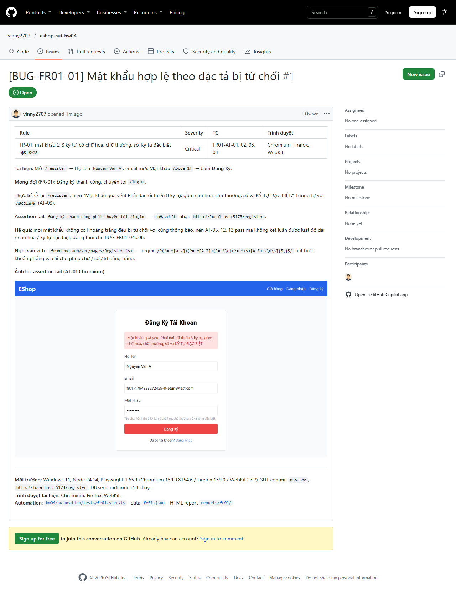
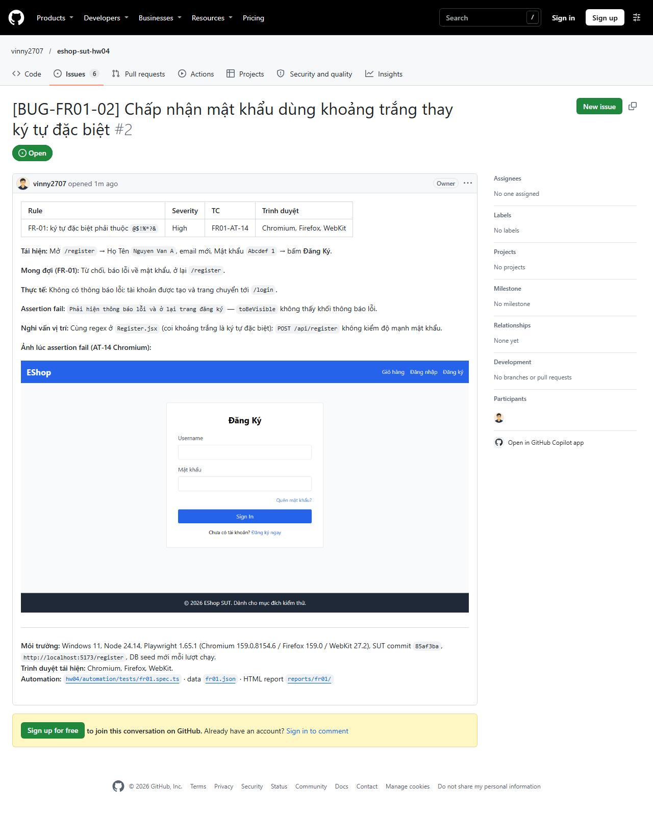
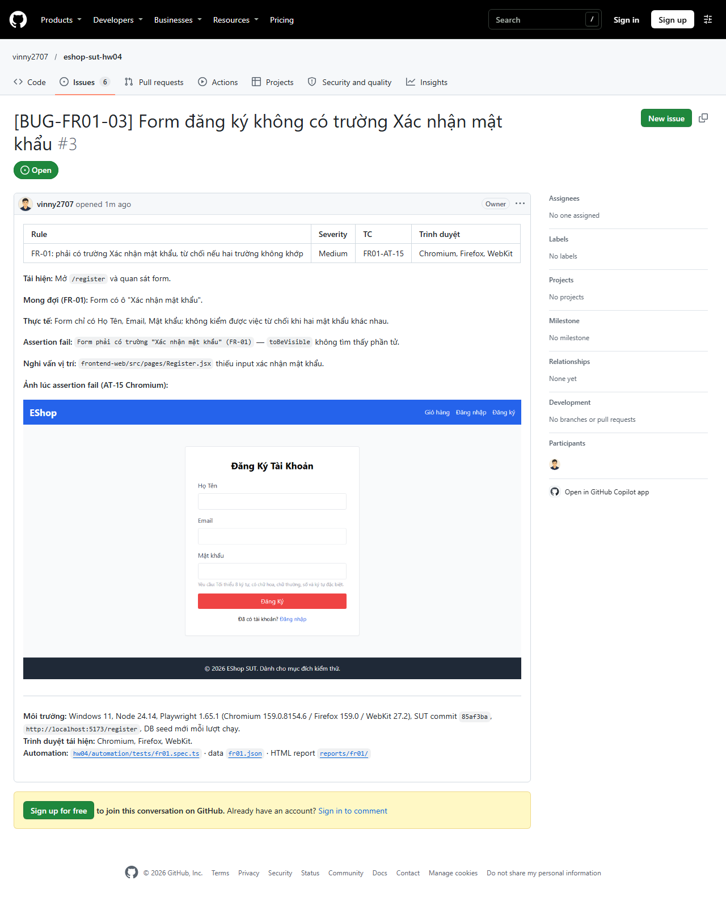
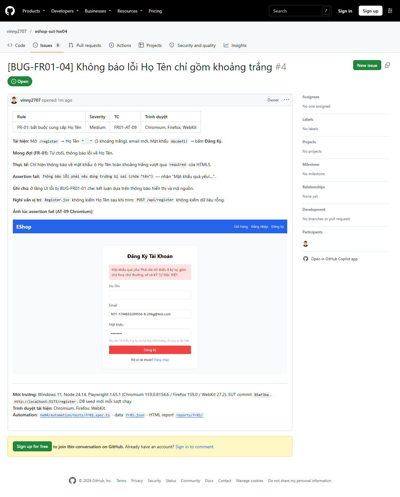
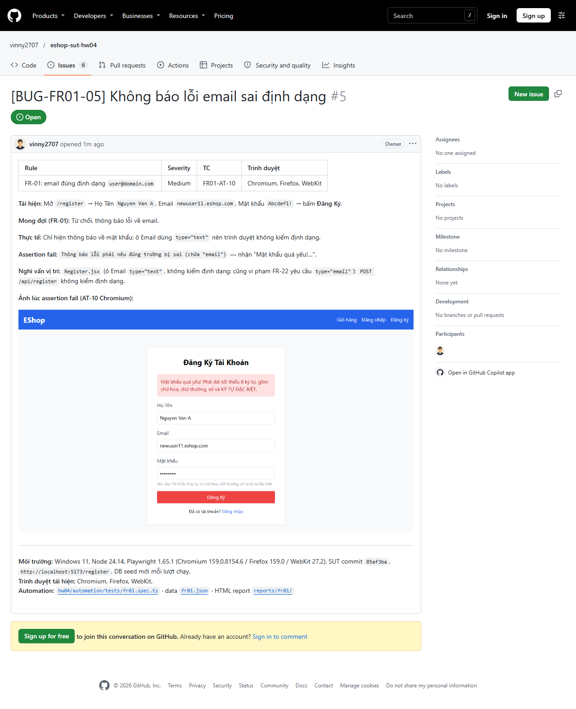
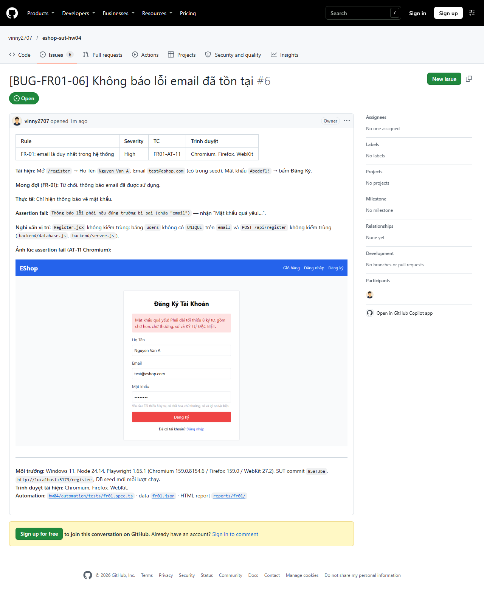
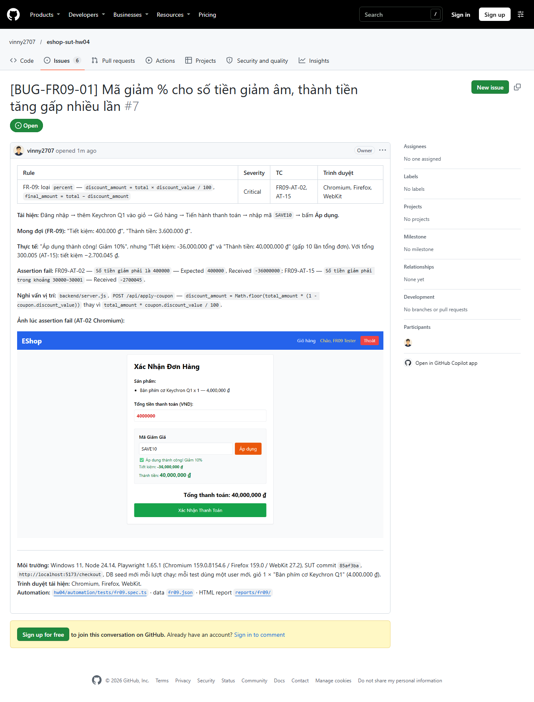
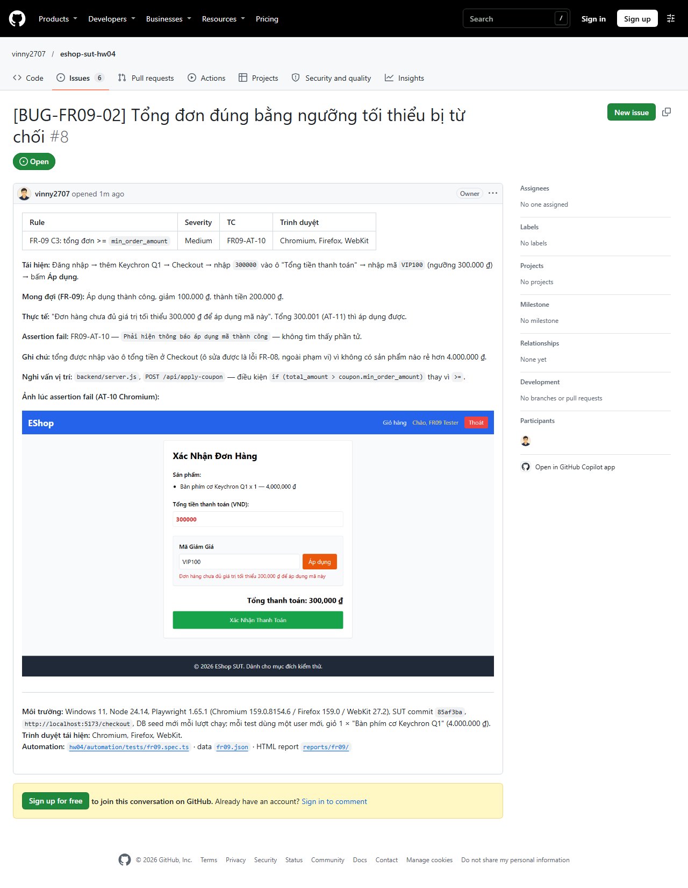
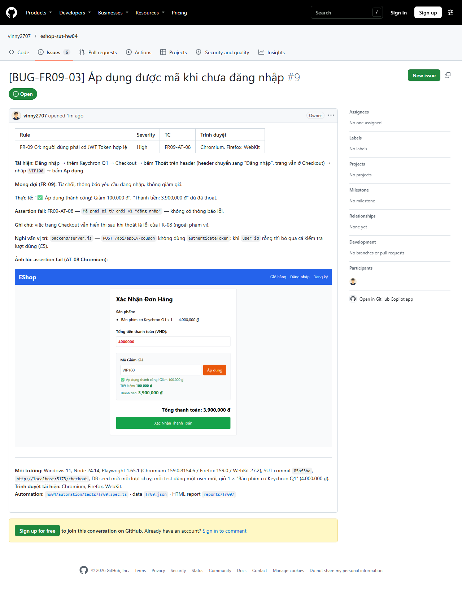

# HW04 — Bug Report

Báo cáo lỗi chi tiết của các tính năng được tự động hóa. Mỗi lỗi gồm luật vi phạm, mức độ, TC và trình duyệt phát hiện, kết quả mong đợi/thực tế và bằng chứng (ảnh chụp lúc assertion fail, ảnh GitHub Issue). Bảng tóm tắt ở report chính: [23120409_HW04_Report.md](23120409_HW04_Report.md).

| FR | Số bug | Mục |
| :-- | :-- | :-- |
| FR-01 Registration | 6 | [FR-01](#fr-01--registration) |
| FR-09 Discount Coupons | 3 | [FR-09](#fr-09--discount-coupons) |
| FR-17 Coupon CRUD | | [FR-17](#fr-17--coupon-crud) |

## FR-01 — Registration

Môi trường: Windows 11, Node 24.14, Playwright 1.65.1 (Chromium 159.0.8154.6 / Firefox 159.0 / WebKit 27.2), SUT commit `85af3ba`, `http://localhost:5173/register`, DB seed mới mỗi lượt chạy. HTML report: [Chromium](../automation/reports/fr01/chromium/index.html) · [Firefox](../automation/reports/fr01/firefox/index.html) · [WebKit](../automation/reports/fr01/webkit/index.html) (Firefox 2026-11-16T12:28Z, WebKit 12:30Z, Chromium 12:47Z).

Dữ liệu cơ sở: Họ Tên `Nguyen Van A`, mật khẩu `Abcdef1!`, email duy nhất mỗi TC (trừ khi ghi khác). Mọi bug tái hiện trên **cả 3 trình duyệt**.

| Bug ID | Tiêu đề | Severity | TC liên quan | Trình duyệt | GitHub Issue |
| :-- | :-- | :-- | :-- | :-- | :-- |
| BUG-FR01-01 | Mật khẩu hợp lệ theo đặc tả bị từ chối | Critical | AT-01, 02, 03, 04 (che khuất AT-05, 12, 13) | Chromium, Firefox, WebKit | [#1](https://github.com/vinny2707/eshop-sut-hw04/issues/1) |
| BUG-FR01-02 | Chấp nhận mật khẩu dùng khoảng trắng thay ký tự đặc biệt | High | AT-14 | Chromium, Firefox, WebKit | [#2](https://github.com/vinny2707/eshop-sut-hw04/issues/2) |
| BUG-FR01-03 | Không có trường Xác nhận mật khẩu | Medium | AT-15 | Chromium, Firefox, WebKit | [#3](https://github.com/vinny2707/eshop-sut-hw04/issues/3) |
| BUG-FR01-04 | Không báo lỗi Họ Tên chỉ gồm khoảng trắng | Medium | AT-09 | Chromium, Firefox, WebKit | [#4](https://github.com/vinny2707/eshop-sut-hw04/issues/4) |
| BUG-FR01-05 | Không báo lỗi email sai định dạng | Medium | AT-10 | Chromium, Firefox, WebKit | [#5](https://github.com/vinny2707/eshop-sut-hw04/issues/5) |
| BUG-FR01-06 | Không báo lỗi email đã tồn tại | High | AT-11 | Chromium, Firefox, WebKit | [#6](https://github.com/vinny2707/eshop-sut-hw04/issues/6) |

### BUG-FR01-01 — Mật khẩu hợp lệ theo đặc tả bị từ chối

| Rule | Severity | TC | Trình duyệt |
| :-- | :-- | :-- | :-- |
| FR-01: mật khẩu ≥ 8 ký tự, có chữ hoa, chữ thường, số, ký tự đặc biệt `@$!%*?&` | Critical | AT-01, 02, 03, 04 | Chromium, Firefox, WebKit |

- **Tái hiện:** mở `/register` → Họ Tên `Nguyen Van A`, email mới, Mật khẩu `Abcdef1!` → bấm **Đăng Ký**.
- **Mong đợi** (FR-01): đăng ký thành công, chuyển tới `/login`.
- **Thực tế:** ở lại `/register`, hiện "Mật khẩu quá yếu! Phải dài tối thiểu 8 ký tự, gồm chữ hoa, chữ thường, số và KÝ TỰ ĐẶC BIỆT." Tương tự với `ABcd12@$` (AT-03).
- **Assertion fail:** `tests/fr01.spec.ts` (nhánh thành công), FR01-AT-01…04 — `Đăng ký thành công phải chuyển tới /login` — `toHaveURL` nhận `http://localhost:5173/register`.
- **Hệ quả:** mọi mật khẩu không có khoảng trắng đều bị từ chối với cùng thông báo, nên AT-05, 12, 13 pass mà không kết luận được luật độ dài / chữ hoa / ký tự đặc biệt; đồng thời che các lỗi BUG-FR01-04…06.
- **Nghi vấn vị trí:** `frontend-web/src/pages/Register.jsx` — regex `/^(?=.*[a-z])(?=.*[A-Z])(?=.*\d)(?=.*\s)[A-Za-z\d\s]{8,}$/` bắt buộc khoảng trắng (`\s`) và chỉ cho phép chữ / số / khoảng trắng.

**GitHub Issue:** [#1](https://github.com/vinny2707/eshop-sut-hw04/issues/1)

---

### BUG-FR01-02 — Chấp nhận mật khẩu dùng khoảng trắng thay ký tự đặc biệt

| Rule | Severity | TC | Trình duyệt |
| :-- | :-- | :-- | :-- |
| FR-01: ký tự đặc biệt phải thuộc `@$!%*?&` | High | AT-14 | Chromium, Firefox, WebKit |

- **Tái hiện:** mở `/register` → Họ Tên `Nguyen Van A`, email mới, Mật khẩu `Abcdef 1` → bấm **Đăng Ký**.
- **Mong đợi** (FR-01): từ chối, báo lỗi về mật khẩu, ở lại `/register`.
- **Thực tế:** không có thông báo lỗi; tài khoản được tạo và trang chuyển tới `/login`.
- **Assertion fail:** FR01-AT-14 — `Phải hiện thông báo lỗi và ở lại trang đăng ký` — `toBeVisible` không thấy khối thông báo lỗi.
- **Nghi vấn vị trí:** cùng regex ở `Register.jsx` (coi khoảng trắng là ký tự đặc biệt); `POST /api/register` không kiểm độ mạnh mật khẩu.

**GitHub Issue:** [#2](https://github.com/vinny2707/eshop-sut-hw04/issues/2)

---

### BUG-FR01-03 — Không có trường Xác nhận mật khẩu

| Rule | Severity | TC | Trình duyệt |
| :-- | :-- | :-- | :-- |
| FR-01: phải có trường Xác nhận mật khẩu, từ chối nếu hai trường không khớp | Medium | AT-15 | Chromium, Firefox, WebKit |

- **Tái hiện:** mở `/register` và quan sát form.
- **Mong đợi** (FR-01): form có ô "Xác nhận mật khẩu".
- **Thực tế:** form chỉ có Họ Tên, Email, Mật khẩu; không kiểm được việc từ chối khi hai mật khẩu khác nhau.
- **Assertion fail:** FR01-AT-15 — `Form phải có trường "Xác nhận mật khẩu" (FR-01)` — `toBeVisible` không tìm thấy phần tử.
- **Nghi vấn vị trí:** `frontend-web/src/pages/Register.jsx` thiếu input xác nhận mật khẩu.

**GitHub Issue:** [#3](https://github.com/vinny2707/eshop-sut-hw04/issues/3)

---

### BUG-FR01-04 — Không báo lỗi Họ Tên chỉ gồm khoảng trắng

| Rule | Severity | TC | Trình duyệt |
| :-- | :-- | :-- | :-- |
| FR-01: bắt buộc cung cấp Họ Tên | Medium | AT-09 | Chromium, Firefox, WebKit |

- **Tái hiện:** mở `/register` → Họ Tên `"   "` (3 khoảng trắng), email mới, Mật khẩu `Abcdef1!` → bấm **Đăng Ký**.
- **Mong đợi** (FR-01): từ chối, thông báo lỗi về Họ Tên.
- **Thực tế:** chỉ hiện thông báo về mật khẩu; ô Họ Tên toàn khoảng trắng vượt qua `required` của HTML5.
- **Assertion fail:** FR01-AT-09 — `Thông báo lỗi phải nêu đúng trường bị sai (chứa "tên")` — nhận "Mật khẩu quá yếu!…".
- **Nghi vấn vị trí:** `Register.jsx` không kiểm Họ Tên sau khi trim; `POST /api/register` không kiểm dữ liệu rỗng. Ở tầng UI lỗi bị BUG-FR01-01 che, kết luận dựa trên thông báo hiển thị và mã nguồn.

**GitHub Issue:** [#4](https://github.com/vinny2707/eshop-sut-hw04/issues/4)

---

### BUG-FR01-05 — Không báo lỗi email sai định dạng

| Rule | Severity | TC | Trình duyệt |
| :-- | :-- | :-- | :-- |
| FR-01: email đúng định dạng `user@domain.com` | Medium | AT-10 | Chromium, Firefox, WebKit |

- **Tái hiện:** mở `/register` → Họ Tên `Nguyen Van A`, Email `newuser11.eshop.com`, Mật khẩu `Abcdef1!` → bấm **Đăng Ký**.
- **Mong đợi** (FR-01): từ chối, thông báo lỗi về email.
- **Thực tế:** chỉ hiện thông báo về mật khẩu; ô Email dùng `type="text"` nên trình duyệt không kiểm định dạng.
- **Assertion fail:** FR01-AT-10 — `Thông báo lỗi phải nêu đúng trường bị sai (chứa "email")` — nhận "Mật khẩu quá yếu!…".
- **Nghi vấn vị trí:** `Register.jsx` (ô Email `type="text"`, không kiểm định dạng; cũng vi phạm FR-22 yêu cầu `type="email"`); `POST /api/register` không kiểm định dạng.

**GitHub Issue:** [#5](https://github.com/vinny2707/eshop-sut-hw04/issues/5)

---

### BUG-FR01-06 — Không báo lỗi email đã tồn tại

| Rule | Severity | TC | Trình duyệt |
| :-- | :-- | :-- | :-- |
| FR-01: email là duy nhất trong hệ thống | High | AT-11 | Chromium, Firefox, WebKit |

- **Tái hiện:** mở `/register` → Họ Tên `Nguyen Van A`, Email `test@eshop.com` (có trong seed), Mật khẩu `Abcdef1!` → bấm **Đăng Ký**.
- **Mong đợi** (FR-01): từ chối, thông báo email đã được sử dụng.
- **Thực tế:** chỉ hiện thông báo về mật khẩu.
- **Assertion fail:** FR01-AT-11 — `Thông báo lỗi phải nêu đúng trường bị sai (chứa "email")` — nhận "Mật khẩu quá yếu!…".
- **Nghi vấn vị trí:** `Register.jsx` không kiểm trùng; bảng `users` không có ràng buộc `UNIQUE` trên `email` và `POST /api/register` không kiểm trùng (`backend/database.js`, `backend/server.js`).

**GitHub Issue:** [#6](https://github.com/vinny2707/eshop-sut-hw04/issues/6)

---

## FR-09 — Discount Coupons

Môi trường: Windows 11, Node 24.14, Playwright 1.65.1 (Chromium 159.0.8154.6 / Firefox 159.0 / WebKit 27.2), SUT commit `85af3ba`, `http://localhost:5173/checkout`, DB seed mới mỗi lượt chạy. HTML report: [Chromium](../automation/reports/fr09/chromium/index.html) · [Firefox](../automation/reports/fr09/firefox/index.html) · [WebKit](../automation/reports/fr09/webkit/index.html) (lượt chạy 2026-11-16T15:05Z–15:08Z).

Dữ liệu cơ sở: user mới đăng ký cho mỗi test, giỏ 1 × "Bàn phím cơ Keychron Q1" (4.000.000 ₫) thêm ở Trang chủ, đi tới Checkout bằng click. Mọi bug tái hiện trên **cả 3 trình duyệt**.

| Bug ID | Tiêu đề | Severity | TC liên quan | Trình duyệt | GitHub Issue |
| :-- | :-- | :-- | :-- | :-- | :-- |
| BUG-FR09-01 | Mã giảm % cho số tiền giảm âm, thành tiền tăng gấp nhiều lần | Critical | AT-02, AT-15 | Chromium, Firefox, WebKit | [#7](https://github.com/vinny2707/eshop-sut-hw04/issues/7) |
| BUG-FR09-02 | Tổng đơn đúng bằng ngưỡng tối thiểu bị từ chối | Medium | AT-10 | Chromium, Firefox, WebKit | [#8](https://github.com/vinny2707/eshop-sut-hw04/issues/8) |
| BUG-FR09-03 | Áp dụng được mã khi chưa đăng nhập | High | AT-08 | Chromium, Firefox, WebKit | [#9](https://github.com/vinny2707/eshop-sut-hw04/issues/9) |

### BUG-FR09-01 — Mã giảm % cho số tiền giảm âm, thành tiền tăng gấp nhiều lần

| Rule | Severity | TC | Trình duyệt |
| :-- | :-- | :-- | :-- |
| FR-09: loại `percent` — `discount_amount = total × discount_value / 100`, `final_amount = total − discount_amount` | Critical | AT-02, AT-15 | Chromium, Firefox, WebKit |

- **Tái hiện:** đăng nhập → thêm Keychron Q1 vào giỏ → Giỏ hàng → Tiến hành thanh toán → nhập mã `SAVE10` → bấm **Áp dụng**.
- **Mong đợi** (FR-09): "Tiết kiệm: 400.000 ₫", "Thành tiền: 3.600.000 ₫".
- **Thực tế:** "Áp dụng thành công! Giảm 10%", nhưng "Tiết kiệm: -36,000,000 ₫" và "Thành tiền: 40,000,000 ₫" (gấp 10 lần tổng đơn). Với tổng 300.005 (AT-15): tiết kiệm −2.700.045 ₫.
- **Assertion fail:** FR09-AT-02 — `Số tiền giảm phải là 400000` — Expected `400000`, Received `-36000000`; FR09-AT-15 — `Số tiền giảm phải trong khoảng 30000–30001` — Received `-2700045`.
- **Nghi vấn vị trí:** `backend/server.js`, `POST /api/apply-coupon` — `discount_amount = Math.floor(total_amount * (1 - coupon.discount_value))` thay vì `total_amount * coupon.discount_value / 100`.

**GitHub Issue:** [#7](https://github.com/vinny2707/eshop-sut-hw04/issues/7)

---

### BUG-FR09-02 — Tổng đơn đúng bằng ngưỡng tối thiểu bị từ chối

| Rule | Severity | TC | Trình duyệt |
| :-- | :-- | :-- | :-- |
| FR-09 C3: tổng đơn **>=** `min_order_amount` | Medium | AT-10 | Chromium, Firefox, WebKit |

- **Tái hiện:** đăng nhập → thêm Keychron Q1 → Checkout → nhập `300000` vào ô "Tổng tiền thanh toán" → nhập mã `VIP100` (ngưỡng 300.000 ₫) → bấm **Áp dụng**.
- **Mong đợi** (FR-09): áp dụng thành công, giảm 100.000 ₫, thành tiền 200.000 ₫.
- **Thực tế:** "Đơn hàng chưa đủ giá trị tối thiểu 300,000 ₫ để áp dụng mã này". Tổng 300.001 (AT-11) thì áp dụng được.
- **Assertion fail:** FR09-AT-10 — `Phải hiện thông báo áp dụng mã thành công` — không tìm thấy phần tử.
- **Ghi chú:** tổng được nhập vào ô tổng tiền ở Checkout (ô sửa được là lỗi FR-08, ngoài phạm vi) vì không có sản phẩm nào rẻ hơn 4.000.000 ₫.
- **Nghi vấn vị trí:** `backend/server.js`, `POST /api/apply-coupon` — điều kiện `if (total_amount > coupon.min_order_amount)` thay vì `>=`.

**GitHub Issue:** [#8](https://github.com/vinny2707/eshop-sut-hw04/issues/8)

---

### BUG-FR09-03 — Áp dụng được mã khi chưa đăng nhập

| Rule | Severity | TC | Trình duyệt |
| :-- | :-- | :-- | :-- |
| FR-09 C4: người dùng phải có JWT Token hợp lệ | High | AT-08 | Chromium, Firefox, WebKit |

- **Tái hiện:** đăng nhập → thêm Keychron Q1 → Checkout → bấm **Thoát** trên header (header chuyển sang "Đăng nhập", trang vẫn ở Checkout) → nhập `VIP100` → bấm **Áp dụng**.
- **Mong đợi** (FR-09): từ chối, thông báo yêu cầu đăng nhập, không giảm giá.
- **Thực tế:** "✅ Áp dụng thành công! Giảm 100,000 ₫", "Thành tiền: 3,900,000 ₫" dù đã thoát.
- **Assertion fail:** FR09-AT-08 — `Mã phải bị từ chối vì "đăng nhập"` — không có thông báo lỗi.
- **Ghi chú:** việc trang Checkout vẫn hiển thị sau khi thoát là lỗi của FR-08 (ngoài phạm vi).
- **Nghi vấn vị trí:** `backend/server.js` — `POST /api/apply-coupon` không dùng `authenticateToken`; khi `user_id` rỗng thì bỏ qua cả kiểm tra lượt dùng (C5).

**GitHub Issue:** [#9](https://github.com/vinny2707/eshop-sut-hw04/issues/9)

---

## FR-17 — Coupon CRUD

Môi trường: . HTML report:

| Bug ID | Tiêu đề | Severity | TC liên quan | Trình duyệt | GitHub Issue |
| :-- | :-- | :-- | :-- | :-- | :-- |
| BUG-FR17-01 | | | | | |
